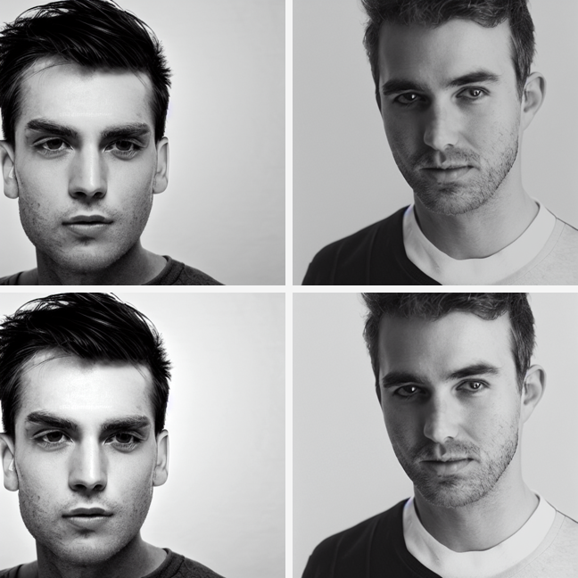
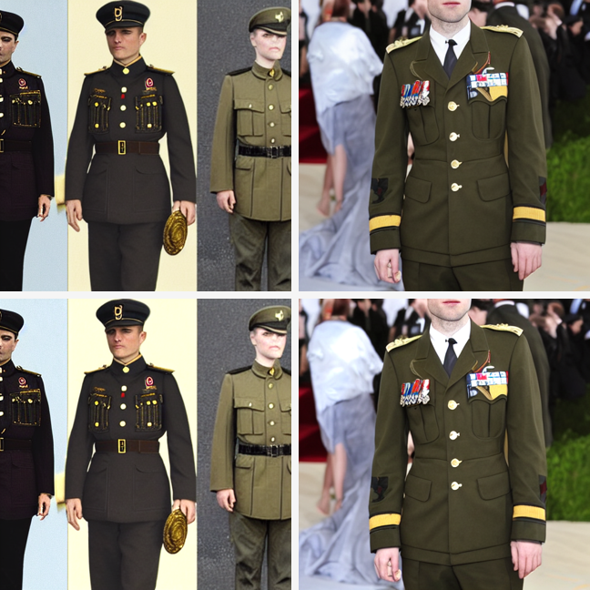
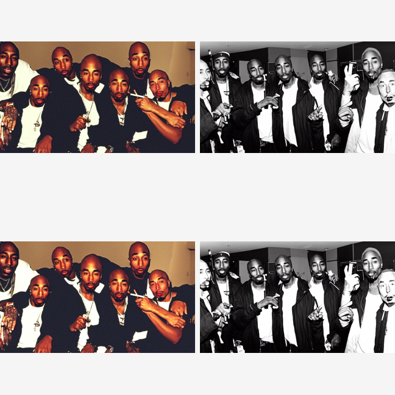

# 调亮同一对候选图后，HPS v2.1 的分差与排序

ImageRewardDB 验证集，64 对图，64 条不同的原提示词，共 512 个图文评分。每对图共享两个提示词和同一组输入像素。P1 在原文后统一追加 “The scene is at night, with dim lighting.”。

## 分差与翻转

追加夜景要求后，亮度响应的改变量 |I| 中位数为 **0.00036621**，第 25 和 75 百分位数分别为 0.00024414、0.00088501。在逐对比较中，P1 的 |Δ| 有 29 对更大、29 对更小、6 对相等。这些数描述固定样本的模型响应。|I| 衡量响应的改变量，增幅的方向由配对的 |Δ| 比较给出。

| 提示词 | abs(Δ) 中位数 | abs(Δ) 四分位区间 | 调亮翻转 | 调亮比较含同分 | TTA 翻转 | TTA 比较含同分 |
|---|---:|---:|---:|---:|---:|---:|
| P0 原提示词 | 0.00170898 | 0.00097656–0.00326538 | 2/64 | 0 | 0/64 | 1 |
| P1 追加夜景 | 0.00177002 | 0.00073242–0.00302124 | 0/64 | 1 | 0/64 | 0 |

分差均为 A 减 B。Δ = d1 − d0，I = Δ(P1) − Δ(P0)。表中翻转分别比较 L0 与 L1、L0 与 TTA，两端严格异号才计入；任一端为零单列。四分位数用线性插值。

## P0 与原图人工偏好

| 原图判定 → TTA 判定 | TTA 选对 | TTA 选错 | TTA 同分 | 原图合计 |
|---|---:|---:|---:|---:|
| 原图选对 | 42 | 0 | 1 | 43 |
| 原图选错 | 0 | 21 | 0 | 21 |
| 原图同分 | 0 | 0 | 0 | 0 |
| TTA 合计 | 42 | 21 | 1 | 64 |

原图选中人工赢家 43/64，TTA 选中 42/64。错→对 0 对，对→错 0 对。这些标签来自原提示词和原图。P1 仅评价模型响应。

## 原提示词的光照要求

打分前逐条检查原提示词，23/64 条有明确的时间、明暗、光源或布光措辞。其中夜间 2 条、低照度或黑暗 3 条、白天或晴亮 3 条、晨昏类 3 条，其余 12 条指定灯光风格或光源。分类按每条提示词的主要要求互斥计数，含 dawn 和 sunny summer day 的同一条归入白天或晴亮。仅有 cinematic、色名、摄影风格、暗色物体或剪影不足以归类。lighting.csv 列出逐条原文证据。夜景追加语有时强化旧要求，有时与白天或晴亮要求冲突，因此总体响应混合了多种语义关系。

官方 tokenizer 的上下文为 77 个 token（含首尾标记）。P0 有 3 条超长，P1 有 9 条超长；追加前后实际 token 完全相同的有 3 对。长提示词可能让追加语部分或全部被截断。统计保留了所有预先抽中的样本。

## |I| 最大的三个图对

下表的箭头依次为原图、调亮、TTA 均值的模型选择。案例按 |I| 降序，同值按 pair_id 升序。
第三名的 |I| 并列图对为 014、036、053，以下按上述顺序展示。

### 图对 003 · |I| = 0.00170898

A large-format portrait of a handsome man behind a white backdrop, spot-lighting, depth of field, high contrast, black and white, grainy

预览上排为原图，下排为 1.1 倍亮度，左 A、右 B。用于评分的是 RGB 输入。

| 提示词 | d0 | d1 | Δ | d_TTA | 模型选择 |
|---|---:|---:|---:|---:|---|
| P0 | 0.00537109 | 0.00415039 | -0.00122070 | 0.00476074 | A → A → A |
| P1 | 0.00292969 | 0.00000000 | -0.00292969 | 0.00146484 | A → tie → A |

有符号 I = -0.00170898。P0 原图人工赢家为 B。

### 图对 011 · |I| = 0.00146484

robert pattinson wearing wehrmacht general uniform

预览上排为原图，下排为 1.1 倍亮度，左 A、右 B。用于评分的是 RGB 输入。

| 提示词 | d0 | d1 | Δ | d_TTA | 模型选择 |
|---|---:|---:|---:|---:|---|
| P0 | -0.01098633 | -0.01269531 | -0.00170898 | -0.01184082 | B → B → B |
| P1 | -0.01086426 | -0.01110840 | -0.00024414 | -0.01098633 | B → B → B |

有符号 I = 0.00146484。P0 原图人工赢家为 A。

### 图对 014 · |I| = 0.00134277

old picture with tupac shakur and elon musk smoking

预览上排为原图，下排为 1.1 倍亮度，左 A、右 B。用于评分的是 RGB 输入。

| 提示词 | d0 | d1 | Δ | d_TTA | 模型选择 |
|---|---:|---:|---:|---:|---|
| P0 | 0.01354980 | 0.01306152 | -0.00048828 | 0.01330566 | A → A → A |
| P1 | 0.01525879 | 0.01342773 | -0.00183105 | 0.01434326 | A → A → A |

有符号 I = -0.00134277。P0 原图人工赢家为 A。

## 执行与校验

服务器 Keqing，单张 NVIDIA GeForce RTX 4080 SUPER，物理 GPU 0。两个评分阶段累计 166.02 秒（含加载、校验与评分，不含下载、环境准备和报告生成）。

- 目标 2 对，本次新增 2 对，耗时 40.28 秒，累计 16 条评分。
- 目标 64 对，本次新增 62 对，耗时 125.74 秒，累计 512 条评分。

64 条唯一原提示词，每对八种组合各一次，共 512 条有限原始分数，键无重复、字段无缺失。128 组 d_TTA 均逐项验证等于 (d0+d1)/2。官方 CUDA 接口的返回类型为 float16，CSV 完整保留返回值，后续做差与均值采用双精度。原始分数的量化精度会影响接近零的分差和同分。

数据与模型版本、权重和验证集文件的 SHA-256 见 environment.json、manifest.json。
