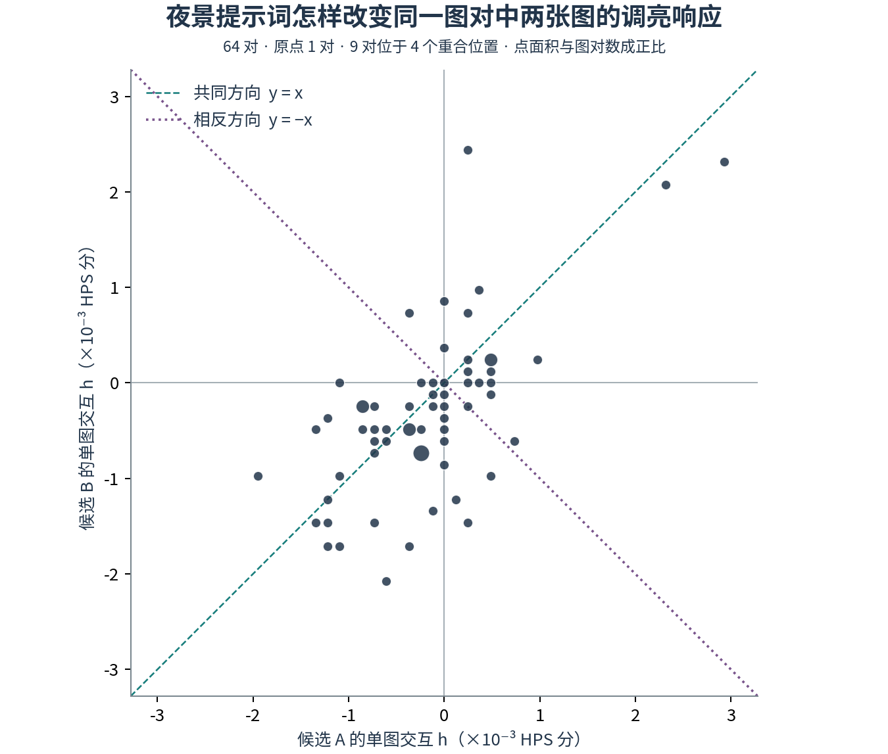
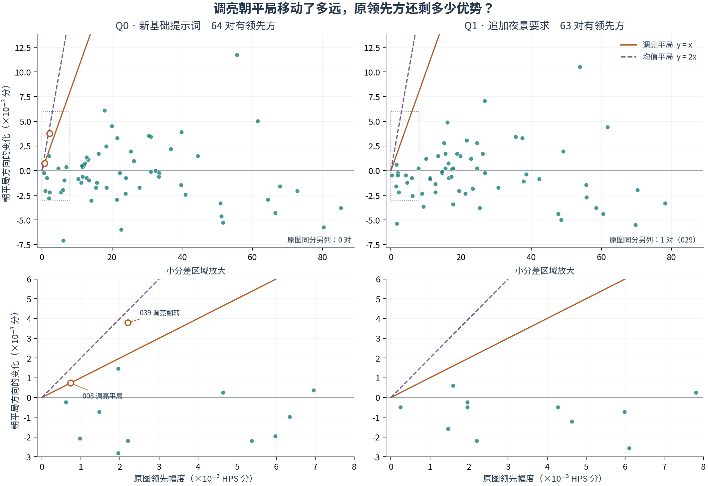

# P1 单图响应分解 · 调亮响应从单图到候选排序

① 在这 64 对图、HPS v2.1 和调亮 10% 的条件下，追加夜景要求使单图调亮响应的有符号中位变化为 **-0.00024414**，绝对变化中位数为 **0.00048828 分**，约合原始输出的 2–4 个可表示步长。

② 变化以两图共有的分量为主，共同分量占交互平方和的 **83.24%**，逐次删一对后为 80.63%–84.78%；少数大响应会影响占比，输出精度也限制了微小差异的分辨。

③ 多数亮度变化维持或扩大原领先优势，即使朝平局移动，Q0、Q1 的位移中位也只覆盖各自原领先幅度的 **9.82%、8.94%**，单一增强幅度只能辨认这一相对门槛，无法独立归因于响应偏小或原分差偏大。

## 分数、条件与独立复算

读取短提示词实验冻结的 64 个图对及图文评分，以图对 ID、A/B、Q0/Q1、L0/L1 作为唯一键。Q0 是重写后的基础提示词，Q1 在其后统一追加夜景与低照度要求。L0 是原图，L1 为在官方预处理前将 RGB 亮度乘以 1.1。八种组合齐全，512 条分数均有限且无重复。图像路径、A/B 顺序、文本 token 哈希、亮度系数与冻结清单相符。

用原始分数逐对重算 G = abs(Δ₁) − abs(Δ₀)，得到增强 / 减弱 / 不变 **23 / 34 / 7**，中位数 -0.0001220703125。64 个 G、I 和两种提示词的原图、调亮与均值分差均与短提示词实验逐对表完全相同。以下计数中的同分和零均指精确相等。

## 1　单图的调亮响应

对候选 X，先在每个提示词下算 b = 调亮分数 − 原图分数，再算 h = b(Q1) − b(Q0)。h 为负表示调亮带来的涨幅缩小或降幅加深。A/B 是随机位置，单图分布将两侧合并；同向性与敏感性检查保留完整图对。方括号表示第 25 至 75 百分位。

| 样本 | 提示词 | 图片数 | 调亮涨分 | 降分 | 同分 |
| --- | --- | --- | --- | --- | --- |
| 全体 | Q0 | 128 | 85 | 40 | 3 |
| 全体 | Q1 | 128 | 79 | 47 | 2 |
| 无语义冲突 | Q0 | 116 | 74 | 39 | 3 |
| 无语义冲突 | Q1 | 116 | 68 | 46 | 2 |

| 样本 | h 中位数 [四分位区间] | h 绝对值中位数 [四分位区间] | 单图 h 正 / 负 / 零 | 图对同正 / 同负 / 异号 / 至少一零 |
| --- | --- | --- | --- | --- |
| 全体 | -0.00024414 [-0.00073242, 0.00012207] | 0.00048828 [0.00024414, 0.00085449] | 34 / 78 / 16 | 11 / 31 / 7 / 15 |
| 无语义冲突 | -0.00024414 [-0.00073242, 0.00012207] | 0.00048828 [0.00024414, 0.00085449] | 31 / 69 / 16 | 10 / 27 / 6 / 15 |

全部 128 张图中，78 张的调亮响应在 Q1 下变得更负，34 张变得更正，16 张完全相同。绝对变化的中位数很小，39 张的绝对变化至多相当于该图四个输入分数中最大的一个 float16 局部步长。这个量级比较没有给单张图划分显著性。

图 1　两轴同尺度，每个坐标是一种 (h_A, h_B) 组合，重复位置合并显示。靠近原点表示两张图都变化很小；远离原点而靠近 y=x 表示两图同向、幅度相近；靠近 y=−x 表示两图近似等量反向。

## 2　两图共有的变化与分差中的变化

C = (h_A + h_B)/2 是两图都分到的共同分量，D = (h_A − h_B)/2 是方向相反的半分差。重建为 h_A = C+D、h_B = C−D。改变提示词后，传到候选分差的交互为 I = h_A − h_B = 2D，共同分量在做差时抵消。逐对同时验证了 C²+D² = (h_A²+h_B²)/2。

| 样本 | C 绝对值中位数 [四分位区间] | D 绝对值中位数 [四分位区间] | 共同更大 / 相等 / 差异更大 | I 绝对值中位数 |
| --- | --- | --- | --- | --- |
| 全体 | 0.00048828 [0.00022888, 0.00073242] | 0.00024414 [0.00006104, 0.00036621] | 42 / 15 / 7 | 0.00048828 |
| 无语义冲突 | 0.00048828 [0.00019836, 0.00073242] | 0.00024414 [0.00007629, 0.00036621] | 37 / 15 / 6 | 0.00048828 |

| 样本 | 共同平方和 | 差异平方和 | 平方和合计 | 共同平方和占比 R | 留一最小–最大 |
| --- | --- | --- | --- | --- | --- |
| 全体 | 4.02480364e-05 | 8.10623169e-06 | 4.83542681e-05 | 83.24% | 80.63%–84.78% |
| 无语义冲突 | 3.70778143e-05 | 7.20098615e-06 | 4.42788005e-05 | 83.74% | 80.94%–85.48% |

R 的分子为 ΣC²，分母为 Σ(C²+D²)，反映按变化幅度平方加权后的样本分配。按图对逐个计数则为 42/64 对共同分量更大。删去 053 得到最小 R，删去 030 得到最大 R。总平方和最大的一对 053 贡献 14.44%，前三对合计贡献 30.68%；同时删去前三对后 R 仍为 79.74%。留一范围是影响诊断，不能当作抽样置信区间。

## 3　原领先幅度与改选门槛

对每个提示词分别算原图分差 d₀ 和同一提示词的 Δ = b_A − b_B。有领先方时记 x = abs(d₀)、y = −sign(d₀) × Δ；y 为负扩大领先，y 为正缩小领先。只看调亮图时，y = x 打平，y > x 严格翻转。等权均值分差为 d₀ + Δ/2，达到平局需要 y = 2x。此处跨界使用该提示词的 Δ。

| 样本 | 提示词 | 比较终点 | 同向扩大 | 反向未跨零 | 恰好打平 | 严格翻转 | 原图同分 | 零响应 |
| --- | --- | --- | --- | --- | --- | --- | --- | --- |
| 全体 | Q0 | 调亮 | 38 | 23 | 1 | 1 | 0 | 1 |
| 全体 | Q0 | 等权均值 | 38 | 25 | 0 | 0 | 0 | 1 |
| 全体 | Q1 | 调亮 | 39 | 24 | 0 | 0 | 1 | 0 |
| 全体 | Q1 | 等权均值 | 39 | 24 | 0 | 0 | 1 | 0 |
| 无语义冲突 | Q0 | 调亮 | 34 | 22 | 1 | 0 | 0 | 1 |
| 无语义冲突 | Q0 | 等权均值 | 34 | 23 | 0 | 0 | 0 | 1 |
| 无语义冲突 | Q1 | 调亮 | 34 | 23 | 0 | 0 | 1 | 0 |
| 无语义冲突 | Q1 | 等权均值 | 34 | 23 | 0 | 0 | 1 | 0 |

| 提示词（全体） | 原领先幅度中位数 | 绝对亮度响应中位数 | 朝平局移动对数 | 这些对的原领先中位数 | 朝平局位移中位数 | 逐对覆盖比例中位数 |
| --- | --- | --- | --- | --- | --- | --- |
| Q0 | 0.01916504 | 0.00170898 | 25 | 0.01782227 | 0.00170898 | 9.82% |
| Q1 | 0.0177002 | 0.00170898 | 24 | 0.01928711 | 0.00170898 | 8.94% |

图 2　上排显示全部有原始领先方的样本，下排放大虚框内的小分差区域。原图同分时朝向平局的方向未定义，另列在面板内。逐对覆盖比例取朝平局移动样本的 y/x 后求中位数。

Q0 下，008 调亮后刚好打平；039 是唯一严格翻转，朝平局移动 0.00378418 分，超过原领先的 0.00219727 分，但未达其两倍。Q1 下，029 从原图同分变为调亮和均值均选 B，单列为原图同分。

在固定 10% 调亮下，能直接判定的限制是方向与跨界距离。要区分这种距离主要源于亮度不足、任务本身的候选差异，还是评分器分辨率，需要改变亮度幅度，并在可比较的原始分差层内复测；精度作用另需较高精度输出作对照。Q0、Q1 的选择均指模型选择。

## 4　精度与精确的零

评分脚本将模型置于推理路径并校验 eval 状态，环境与实际 smoke/full.log 记录 CUDA AMP；已核对版本哈希一致的官方 img_score.py，前向和特征点积均在 autocast 中执行。每个算子及其内部累加使用的精确 dtype **无法从现有文件确认**。

512 行的 native_dtype 都为 float16。评分脚本用 float(v) 提升返回值，再写入缓存与 CSV。逐个验证每个 CSV 十进制数与其读回的 binary64 值精确相等，并且均能无损转回 float16。分数范围 [0.1287841796875, 0.32177734375]，共有 388 个唯一值。按大小排序，相邻唯一值有 387 个间隔、23 种长度，最小 0.0001220703125，最大 0.0059814453125。最小间隔出现 91 次，二倍间隔出现 128 次；逐间隔频数保存在 summary.csv。

该分数范围跨过 0.25。低于 0.25 时，相邻可表示 float16 分数的间隔为 0.0001220703125；从 0.25 起为 0.000244140625。观测到的更大间隔可跨过未取到的可表示值。dtype 的判断还依据 CSV 的原始返回类型记录；仅看步长，无法确定所有前向运算的精度。

全体 G 的两个中间值均为 -0.0001220703125，所以中位数就是这个值。无冲突组的两个中间值为 -0.0001220703125 与 0.0，取平均得到 -6.103515625e-05，恰为半个最小输出步长的负值。C、D 也包含除以二，因此衍生量可以落在原始分数网格之间。

| 样本 | 单图 h 精确为零 | 图对 I 精确为零 | 图对 G 精确为零 |
| --- | --- | --- | --- |
| 全体 | 16/128 | 6/64 | 7/64 |
| 无语义冲突 | 16/116 | 6/58 | 7/58 |

## 5　三个按固定规则选出的图对

总变化幅度取单图交互的均方根 √(C²+D²)，样本中位数为 0.00059162 分。按图对 ID 升序处理并列。三个规则选中 3 个不同图对。原始分数表保留完整精度，比较表中的 → 依次为原图、调亮图、等权均值。

### 共同分量绝对值最大 · 图对 053

A hybrid of a cat and a chicken.

| 提示词 | A 原图 | A 调亮 | B 原图 | B 调亮 | 原图 → 调亮 → 均值 |
| --- | --- | --- | --- | --- | --- |
| Q0 | 0.25146484375 | 0.2457275390625 | 0.25341796875 | 0.25048828125 | B → B → B |
| Q1 | 0.237060546875 | 0.2342529296875 | 0.2392578125 | 0.2386474609375 | B → B → B |

h_A = 0.0029296875，h_B = 0.0023193359375，C = 0.00262451171875，D = 0.00030517578125，I = 0.0006103515625，总变化幅度 = 0.00264219。

### 差异分量绝对值最大 · 图对 030

A still of Walter White as Batman.

| 提示词 | A 原图 | A 调亮 | B 原图 | B 调亮 | 原图 → 调亮 → 均值 |
| --- | --- | --- | --- | --- | --- |
| Q0 | 0.267822265625 | 0.2666015625 | 0.2452392578125 | 0.238037109375 | A → A → A |
| Q1 | 0.25048828125 | 0.24951171875 | 0.2252197265625 | 0.220458984375 | A → A → A |

h_A = 0.000244140625，h_B = 0.00244140625，C = 0.0013427734375，D = -0.0010986328125，I = -0.002197265625，总变化幅度 = 0.00173495。

### 总变化幅度最接近中位数 · 图对 017

A cultist in white robes and a golden god.

| 提示词 | A 原图 | A 调亮 | B 原图 | B 调亮 | 原图 → 调亮 → 均值 |
| --- | --- | --- | --- | --- | --- |
| Q0 | 0.20947265625 | 0.2122802734375 | 0.2164306640625 | 0.2188720703125 | B → B → B |
| Q1 | 0.2022705078125 | 0.205078125 | 0.20654296875 | 0.2098388671875 | B → B → B |

h_A = 0.0，h_B = 0.0008544921875，C = 0.00042724609375，D = -0.00042724609375，I = -0.0008544921875，总变化幅度 = 0.00060422。

## 复算文件

[逐对分解](pair_decomposition.csv)保留全部八个原始分数、单图变化、分差、选择与留一结果。[汇总数据](summary.csv)使用长表保存所有计数、分位数和步长频数。[README](README.md)给出离线命令与字段说明。
