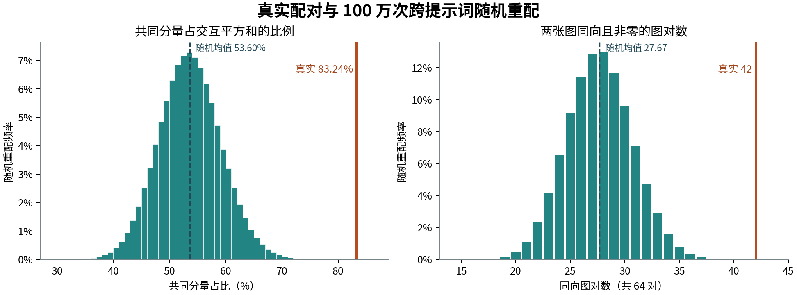

# 夜景条件下，两张候选图是否有额外的同步响应？

同一原提示词下的两张候选图，在这 64 对样本中表现出额外同步性。保留全部单图响应、将 A 与其他提示词下的 B 重新匹配，共同分量占比的期望为 **53.60%**；真实配对为 **83.24%**，高出 **29.64 个百分点**。100 万次重配中，达到或超过真实值的次数为 0。

按图对计数也能看到差异：真实配对有 **42/64 对同向且非零**，随机期望 **27.67 对**。这里每对各投一票，响应幅度最大的图对与其余图对权重相同。

## 跨提示词对照

单图交互 h 是追加夜景要求后，调亮 10% 所引起的评分变化又改变了多少。对每次重配，64 个 A 固定，B 完整地一对一重排。每张图保留原来在自己提示词下测得的 h，包括符号、幅度和精确的零。本轮只重新匹配这些 h。64 个原提示词、Q0 及其 token 输入均逐对唯一，限制 B 不回原位即保证来自其他提示词。

| 样本 | 指标 | 真实配对 | 随机期望 | 随机分布中央 95% | 达到或超过真实值 / 100 万次 |
|---|---|---:|---:|---:|---:|
| 全部 64 对 | 共同分量占比 | 83.24% | 53.60% | 42.99%–64.75% | 0 |
| 全部 64 对 | 同向非零对数 | 42 | 27.67 | 22–34 | 2 |
| 无语义冲突 58 对 | 共同分量占比 | 83.74% | 52.84% | 41.54%–64.82% | 0 |
| 无语义冲突 58 对 | 同向非零对数 | 37 | 24.12 | 19–30 | 3 |

区间是固定这批图、仅改变配对得到的参考范围。主对照严格排除原配对，尾部次数给出描述性的重配参照。作为补充，在 B 身份可交换的零假设下，允许保留原位的普通置换检验也有 0 次共同分量占比达到或超过实测值；单侧 Monte Carlo p = (命中数 + 1)/(100 万 + 1) ≈ 0.000001。有限模拟的零次命中不等于真实尾概率为零。

## 83.24% 是怎么组成的？

设 a、b 为两侧的单图响应，S = Σ(a²+b²)。所有重配的 S 相同，因此 R = 1/2 + Σ(ab)/S。把乘积和按两侧均值展开，真实配对具有如下算术分解。

| 数学基准 | 两侧均值同号的贡献 | 去掉两侧均值后的配对贡献 | 实测 R |
|---:|---:|---:|---:|
| 50.00% | +4.06 个百分点 | +29.18 个百分点 | 83.24% |

50% 来自共同与差异分量的定义。两侧的 h 均值分别为 -0.00018692、-0.00032806。可任意重配时，平均乘积就是两侧均值的乘积，故精确基线为 54.06%。严格排除原配对会移走一批偏大的对角线乘积，基线随之降到 53.60%。前表的 29.64 个百分点使用严格跨提示词基线，本表的 29.18 个百分点使用不限原位的基线。两侧响应去均值后的 Pearson 相关为 0.648。这些量衡量响应间的关联，不能解释成某种机制的因果份额。

## 可以怎样讲给队友

“在这批图里，夜景要求改变了 HPS 对调亮的反应。同一提示词下的两张候选图，比随机跨提示词配成一对的图更容易同向变化。这个差距在忽略响应大小、只数方向时也能看到。”

适用范围是 ImageRewardDB 的这 64 对图、HPS v2.1、冻结的 Q0/Q1 和 1.1 倍亮度。真实候选同时共享提示词，并可能共享题材、构图或其他生成特征。重配对照保留了整批图片偏负的趋势，但不能将额外同步性单独归因于文本或画面。重配后的图像没有跨提示词的排序或人工偏好含义。
