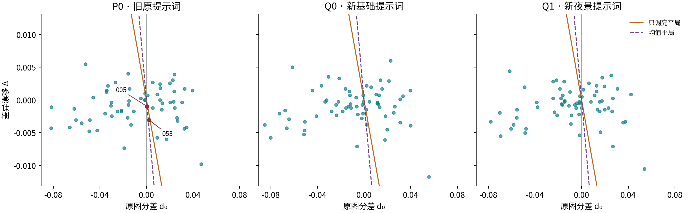
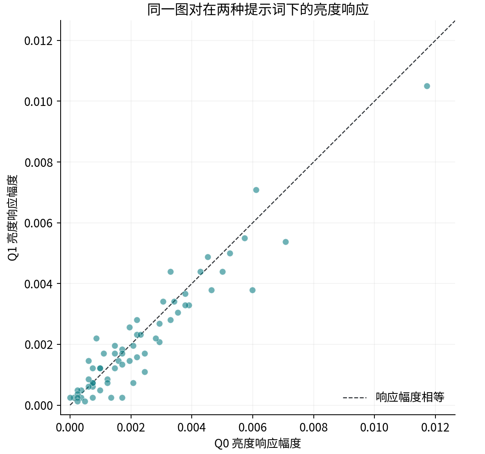
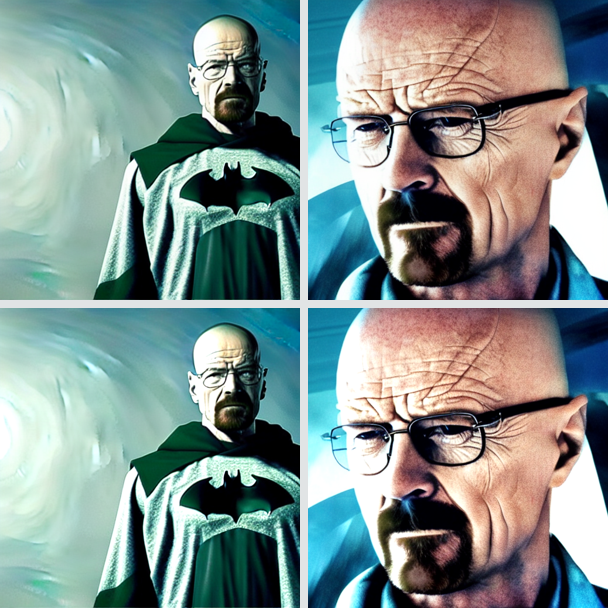
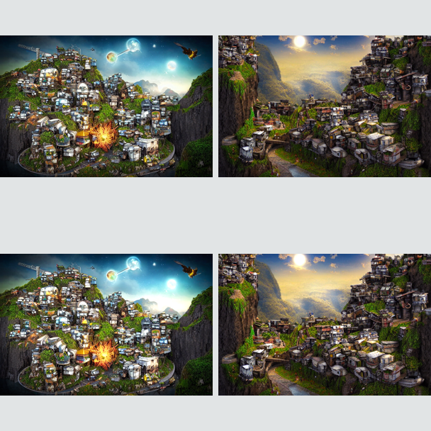
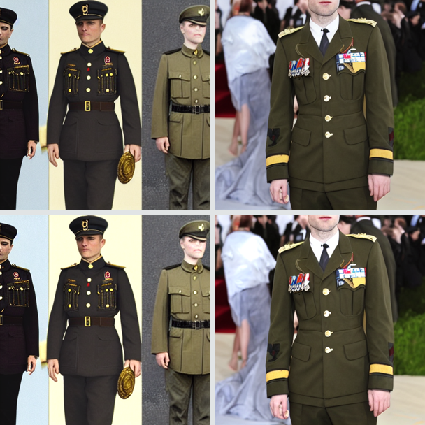
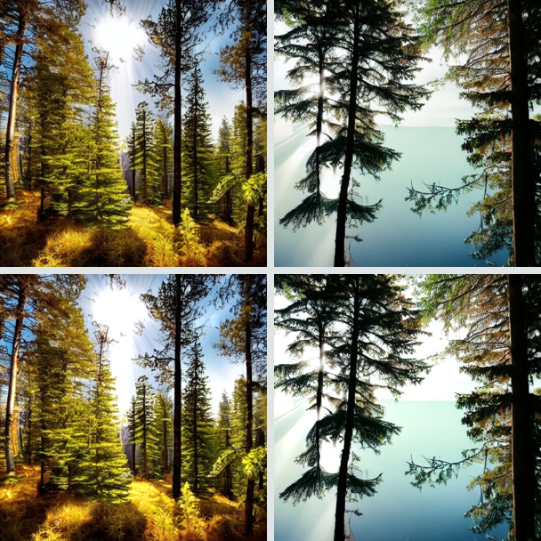
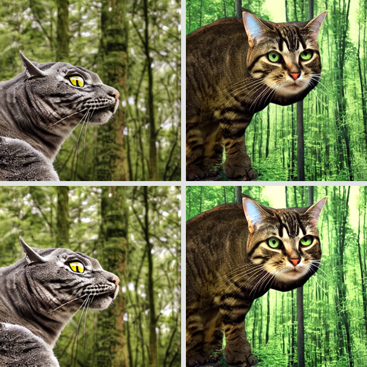
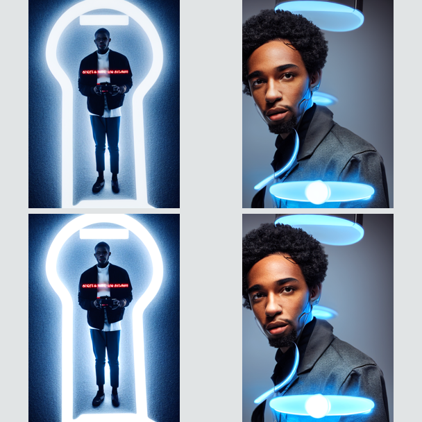

# 亮度增强与夜景提示词的交互：短提示词配对实验

旧 P0 的两次调亮翻转都没有跨过均值的严格翻转边界：005 恰好打平，053 仍选择原来的 A。  

旧提示词中 23 条原有光照描述、9 条追加后截断，两者重叠 5 条；其中 3 条追加前后的模型输入完全相同。  

新短提示词全部完整进入模型，夜景条件下的亮度响应没有一致变强：配对幅度变化 G 的中位数为 -0.00012207，95% bootstrap 区间为 [-0.00030518, 0]。

## A · 旧分差如何跨过两条边界

对同一图对，原分差 d₀ = A₀ − B₀，调亮分差 d₁ = A₁ − B₁，Δ = d₁ − d₀ = δA − δB。共同漂移 (δA + δB)/2 描述两张图整体涨跌，差异漂移 Δ 决定它们之间的分差。等权 TTA 的分差是 d₀ + Δ/2，因而只有调亮后反向的分差绝对值超过原分差，均值才会严格翻转。

按 d₀、d₁ 和均值分差的实际符号分区；r = −Δ/d₀ 仅在 d₀ 非零时计算。每行各分区之和为总数。

| 提示词 | r＜1 · 均保持 | r＝1 · 调亮平 | 1＜r＜2 · 仅调亮翻 | r＝2 · 均值平 | r＞2 · 均翻 | 原图同分 |
|---|---|---|---|---|---|---|
| P0 | 62 | 0 | 1 | 1 | 0 | 0 |
| P1 | 63 | 1 | 0 | 0 | 0 | 0 |
| Q0 | 62 | 1 | 1 | 0 | 0 | 0 |
| Q1 | 63 | 0 | 0 | 0 | 0 | 1 |

### 两个旧翻转的原始分数

| 图对 | P0 人工赢家 | A 原图 | B 原图 | A 调亮 | B 调亮 | 原图 → 调亮 → 均值 |
|---|---|---|---|---|---|---|
| 005 | A | 0.2578125 | 0.25732421875 | 0.26123046875 | 0.26171875 | A → B → 同分 |
| 053 | B | 0.2498779296875 | 0.2476806640625 | 0.2449951171875 | 0.245849609375 | A → B → A |

| 图对 | 原图分差 | 调亮分差 | 差异漂移 Δ | 共同漂移 | 均值分差 | r |
|---|---|---|---|---|---|---|
| 005 | 0.00048828125 | -0.00048828125 | -0.0009765625 | 0.00390625 | 0.0 | 2.0 |
| 053 | 0.002197265625 | -0.0008544921875 | -0.0030517578125 | -0.00335693359375 | 0.00067138671875 | 1.3888888888888888 |

005 两张图都涨分，B 涨得更多。053 两张图都降分，A 降得更多。两次差异漂移都使调亮图选 B，但取均值后，005 由选对变成同分，053 维持原来的错误选择。

按 P0 原图人工标签，原图选对 43/64，TTA 选对 42/64。错→对 0，对→错 0，对→同分 1。旧 scores.csv、pair_results.csv 和报告数值一致。旧评分脚本只输分，旧分析脚本与报告均以严格异号判翻转，任一端为零单列。本表进一步拆开原图同分与新产生的同分。

| 范围 | 方式 | 严格翻转 | 原图同分 | 非同分→同分 | 终点同分 |
|---|---|---|---|---|---|
| P0 | 只看调亮 | 2 | 0 | 0 | 0 |
| P0 | 等权均值 | 0 | 0 | 1 | 1 |
| P1 | 只看调亮 | 0 | 0 | 1 | 1 |
| P1 | 等权均值 | 0 | 0 | 0 | 0 |
| Q0 | 只看调亮 | 1 | 0 | 1 | 1 |
| Q0 | 等权均值 | 0 | 0 | 0 | 0 |
| Q1 | 只看调亮 | 0 | 1 | 0 | 0 |
| Q1 | 等权均值 | 0 | 1 | 0 | 0 |

横轴为原图分差，纵轴为差异漂移。实线 Δ = −d₀ 时调亮图正好打平，虚线 Δ = −2d₀ 时均值正好打平。三面板使用相同坐标范围。

## B · 旧夜景追加语真正送入模型的范围

复用了旧 lighting.csv 的 23 条逐条文本判断。HPS ViT-H-14 实际 tokenizer 输出 77 个位置，长度含起止标记，按结束标记定位非 padding 区域。旧组仅按原文标记和实际 token 分组。I = Δ₁ − Δ₀ 衡量响应改变；G = abs(Δ₁) − abs(Δ₀) 衡量幅度增强或减弱。例如由 +0.002 变为 −0.002，交互绝对值为 0.004，而 G 为零。

| 旧样本组 | 图对 | 原提示词响应幅度中位数 | 夜景响应幅度中位数 | 交互绝对值中位数 | G 中位数 | G 四分位区间 | G 正 / 负 / 零 |
|---|---|---|---|---|---|---|---|
| 全部 | 64 | 0.00170898 | 0.00177002 | 0.00036621 | 0 | [-0.00036621, 0.00027466] | 29 / 29 / 6 |
| 无光照要求且追加完整 | 37 | 0.00244141 | 0.00195312 | 0.00048828 | 0.00012207 | [-0.00036621, 0.00048828] | 19 / 16 / 2 |
| 有光照要求且追加完整 | 18 | 0.00128174 | 0.00091553 | 0.00036621 | 0.00006104 | [-0.00036621, 0.00024414] | 9 / 8 / 1 |
| 追加被截断 | 9 | 0.00170898 | 0.00146484 | 0.00024414 | -0.00024414 | [-0.00024414, 0] | 1 / 5 / 3 |
| ↳ 其中输入完全相同 | 3 | 0.00244141 | 0.00244141 | 0 | 0 | [0, 0] | 0 / 0 / 3 |

前两个完整组和截断组合计 64 对。截断组中，原无光照要求 4 对、已有要求 5 对。039、045、064 的四个对应图像分数在 P0、P1 下逐项相同，每对 I = 0。其余截断样本仍有部分追加语进入模型。逐条 token ID、原文、证据见 [旧提示词核查](old_prompt_audit.csv)。

在追加完整且原无光照要求的 37 对中，19 对增强、16 对减弱、2 对不变。可见截断确实让一部分干预失效，但去掉截断和已有光照要求后，响应方向仍然混合。各子组由原有文本特征决定，组间差异不能单独归因于截断。两个幅度列分别取中位数，G 列先在同一图对内相减再取中位数。

## C · 用短提示词重新评分

保留原图、原 A/B、相同亮度系数和同一评分接口。Q0 以简短英文保留主体、动作与空间关系，删去光照、时段、整体色调和部分风格词；Q1 原样保留 Q0，再追加 “The scene is at night, with dim lighting.”。命名作品、物体固有颜色和作为物体的灯具可保留。最长 Q1 为 47 个 token。每一对的 Q0、Q1 编码不同，后缀 token 全部保留。

| 新样本组 | 图对 | 基础响应幅度中位数 | 夜景响应幅度中位数 | G 中位数 | G 的 95% 区间 | G 正 / 负 / 零 | 交互绝对值中位数 | 交互绝对值四分位区间 |
|---|---|---|---|---|---|---|---|---|
| 全部 · 主结果 | 64 | 0.00170898 | 0.00170898 | -0.00012207 | [-0.00030518, 0] | 23 / 34 / 7 | 0.00048828 | [0.00012207, 0.00073242] |
| 无语义冲突 | 58 | 0.00170898 | 0.00164795 | -0.00006104 | [-0.00030518, 0.00006104] | 22 / 29 / 7 | 0.00048828 | [0.00015259, 0.00073242] |

主结果在打分前指定。对完整图对有放回重采样 10,000 次，每次同时带入该对全部条件，随机种子 42；报告中位数的百分位区间。去掉预标记冲突项后区间跨零，全体的区间上界为零。两组均未显示一致增强。

语义冲突标记采用保守口径，包含时段或发光景观是原文重要内容、删改会削弱原意的样本。冻结时标出的图对为 010、032、039、046、054、057；逐条原因和删除内容见 [提示词清单](prompts.csv)。短提示词也删减了部分画风细节，旧实验与新实验的差异同时包含这些改写的影响。

每一点代表一对图，横纵轴同尺度。对角线上方表示 G 为正，下方表示 G 为负；相同坐标会重叠。

## 六个预先约定规则选出的图对

按交互绝对值降序取前三（同值按图对 ID 升序），从其余图对中用种子 42 随机抽三对。每个缩略图的左列是 A、右列是 B，上排原图、下排调亮。以下为模型原始分数。

### 最大交互 · 图对 030

原文　a still of Walter White as Batman

Q0　A still of Walter White as Batman.

Q1　A still of Walter White as Batman. The scene is at night, with dim lighting.

| 提示词 | A 原图 | B 原图 | A 调亮 | B 调亮 | 亮度响应 Δ |
|---|---|---|---|---|---|
| Q0 | 0.267822265625 | 0.2452392578125 | 0.2666015625 | 0.238037109375 | 0.0059814453125 |
| Q1 | 0.25048828125 | 0.2252197265625 | 0.24951171875 | 0.220458984375 | 0.0037841796875 |

交互绝对值 0.00219727，幅度变化 G = -0.00219727。

### 最大交互 · 图对 046

原文　classical favela sculpture, fantasy shopping environment, industrial factory, cliffs, sunny, milky way, award winning art, epic dreamlike fantasy landscape, ultra realistic,

Q0　A fantasy shopping environment with classical favela sculpture, an industrial factory, cliffs and the Milky Way.

Q1　A fantasy shopping environment with classical favela sculpture, an industrial factory, cliffs and the Milky Way. The scene is at night, with dim lighting.

| 提示词 | A 原图 | B 原图 | A 调亮 | B 调亮 | 亮度响应 Δ |
|---|---|---|---|---|---|
| Q0 | 0.260986328125 | 0.26708984375 | 0.259521484375 | 0.272705078125 | -0.007080078125 |
| Q1 | 0.25390625 | 0.255615234375 | 0.252685546875 | 0.259765625 | -0.00537109375 |

交互绝对值 0.00170898，幅度变化 G = -0.00170898。

### 最大交互 · 图对 011

原文　robert pattinson wearing wehrmacht general uniform

Q0　Robert Pattinson wearing a Wehrmacht general's uniform.

Q1　Robert Pattinson wearing a Wehrmacht general's uniform. The scene is at night, with dim lighting.

| 提示词 | A 原图 | B 原图 | A 调亮 | B 调亮 | 亮度响应 Δ |
|---|---|---|---|---|---|
| Q0 | 0.21533203125 | 0.2337646484375 | 0.2139892578125 | 0.234130859375 | -0.001708984375 |
| Q1 | 0.2099609375 | 0.2244873046875 | 0.2080078125 | 0.2227783203125 | -0.000244140625 |

交互绝对值 0.00146484，幅度变化 G = -0.00146484。

### 随机对照 · 图对 043

原文　detailed in exterior of woods with epic tall pines, particle pollen, god light rays, sparkling lake horizon, infinite atmosphere, calm, in style of greg rutkowsi

Q0　Tall pines in the woods, pollen in the air and a lake on the horizon.

Q1　Tall pines in the woods, pollen in the air and a lake on the horizon. The scene is at night, with dim lighting.

| 提示词 | A 原图 | B 原图 | A 调亮 | B 调亮 | 亮度响应 Δ |
|---|---|---|---|---|---|
| Q0 | 0.2403564453125 | 0.234375 | 0.237548828125 | 0.2296142578125 | 0.001953125 |
| Q1 | 0.2354736328125 | 0.2293701171875 | 0.2315673828125 | 0.222900390625 | 0.0025634765625 |

交互绝对值 0.00061035，幅度变化 G = 0.00061035。

### 随机对照 · 图对 008

原文　a dinosaur with the head of a cat, lightly furry, in a forest

Q0　A lightly furry dinosaur with a cat's head in a forest.

Q1　A lightly furry dinosaur with a cat's head in a forest. The scene is at night, with dim lighting.

| 提示词 | A 原图 | B 原图 | A 调亮 | B 调亮 | 亮度响应 Δ |
|---|---|---|---|---|---|
| Q0 | 0.253662109375 | 0.25439453125 | 0.2548828125 | 0.2548828125 | 0.000732421875 |
| Q1 | 0.243896484375 | 0.2454833984375 | 0.244384765625 | 0.245361328125 | 0.0006103515625 |

交互绝对值 0.00012207，幅度变化 G = -0.00012207。

### 随机对照 · 图对 002

原文　a black man with short curly haircut, portrait, wearing black letter jacket, holding a futuristic looking big cinema camera, light blue led's, sharp focus, octane render, hyperrealistic, cinematic lighting, highly detailed, 8 k,

Q0　A portrait of a Black man with short curly hair and a black leather jacket, holding a large futuristic cinema camera.

Q1　A portrait of a Black man with short curly hair and a black leather jacket, holding a large futuristic cinema camera. The scene is at night, with dim lighting.

| 提示词 | A 原图 | B 原图 | A 调亮 | B 调亮 | 亮度响应 Δ |
|---|---|---|---|---|---|
| Q0 | 0.1923828125 | 0.2568359375 | 0.19140625 | 0.2587890625 | -0.0029296875 |
| Q1 | 0.1978759765625 | 0.253662109375 | 0.1973876953125 | 0.255859375 | -0.002685546875 |

交互绝对值 0.00024414，幅度变化 G = -0.00024414。

## 运行与验收

服务器 Keqing，NVIDIA GeForce RTX 4080 SUPER，物理 GPU 0。HPS v2.1，官方 CUDA AMP，原始输出 float16；CSV 无损保存原始输出，再以 float64 计算全部分差、比值和统计量。模型自身的量化会影响近零分差和同分。软件版本、权重与输入哈希见 [环境记录](environment.json) 和 [冻结记录](freeze.json)。

| 阶段目标 | 新评分 | 本轮缓存命中 | 旧分数命中 | 评分阶段墙钟秒 | 同步 API 秒 | GPU 前向秒 |
|---|---|---|---|---|---|---|
| 2 | 16 | 0 | 0 | 25.73 | 3.64 | 1.36 |
| 64 | 496 | 16 | 0 | 126.09 | 99.98 | 28.04 |

两个评分阶段合计 151.82 秒。GPU 前向累计 29.40 秒，由 CUDA event 在每次模型 forward 前后测量；同步 API 时间含权重加载与官方打分路径。GPU 前向时间不包括点积、主机预处理或脚本初始化。

旧、新评分各有 64 个相同 pair_id、每对 8 条有限分数、各 512 条，候选图像路径和 A/B 映射一致。逐对验证 Δ = δA − δB，均值分差也与两张图分别取均值后再相减严格相等。旧结果仅用于复核，Q0、Q1 的统计只使用模型输出。

## 人工验证待完成

从 64 个图对等概率抽 16 对，种子 42；每对四个条件，共 64 题，题序和左右位置随机化。[盲评页面](human_eval/index.html) 可离线打开，已附空白 CSV。提交题目时只分发页面、assets 与空白表，将私有映射留给分析者。当前没有真实作答。收到标注后，用导入脚本按左右映射解码，分别统计固定提示词下调亮前后的改选、固定图像条件下更换提示词的改选，同分和无法比较分列。
