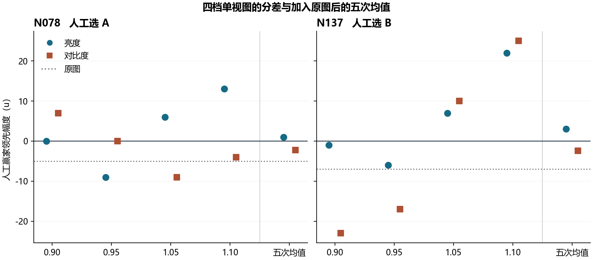
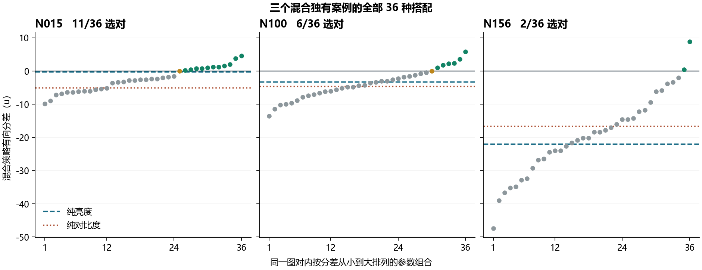

# 评分预算为什么会改变亮度与对比度的纠错覆盖关系

① 三次评分时，N078 的对比度只有 0.90＋0.95 能纠正；N137 只有 0.95＋1.10 和 1.05＋1.10 能纠正。取齐四档后，前者加入的两个高档、后者尤其是 0.90 档拉低了分差，两对都严格选错。四档亮度中两者的 1.10 档都支持人工赢家，五次均值均保持正值。

② 把原图权重固定在 1/3 或 1/5，从选两档改为取齐四档，纯 B、纯 C 共有的可纠正图对均从 5 对降到 0 对。权重影响临界案例；例如 N078 的四档亮度在 1/3 时同分，在 1/5 时选对。把门槛提高到至少 25% 的组合能纠正，三次评分时就已经出现 B 独有 3 对、C 独有 2 对。

③ 五次混合在 N015、N100、N156 分别只以 11/36、6/36、2/36 的概率纠正。均匀选搭配在全体 256 对上期望纠正 2.167 对、改错 2.528 对，选对率比原图和同预算纯 C 都低 0.141 个百分点。这批图支持“个别搭配可纠正”。

## 数据与判定

使用 ImageRewardDB validation 已研究过的 256 个不同提示词，按 P0 和原始人工排序对齐 A/B。原图 175 对选对、81 对选错、0 对同分。从旧评分中读取双方原图和亮度、对比度各四档的 4,608 条分数。两个方法的实际因子均为 0.90、0.95、1.05、1.10。

有向分差 m 为人工赢家分数减另一侧分数。下文用 **u = 1/8192 = 0.0001220703125 HPS 分**显示小数，分差为正、零、负分别对应严格选对、同分、严格选错。CSV 保留 HPS 分的 float64 数值；每个具体组合先用未除以分母的和判符号，再累计概率。

## A　五个共有错例去了哪里

下表格内依次为选对／同分／选错的组合数。三个数各除以该策略的搭配总数即为概率。三次评分的 B、C、BC 分母分别为 6、6、16；五次为 1、1、36。表中七对是两个等权预算下曾被任一策略纠正的全部原始错例。

| 图对 | 人工赢家 | 原图 m₀（u） | 三次 B | 三次 C | 三次 BC | 五次 B | 五次 C | 五次 BC |
|---|---|---|---|---|---|---|---|---|
| N015 | B | -5 | 2/0/4 | 1/0/5 | 5/0/11 | 0/0/1 | 0/0/1 | 11/1/24 |
| N020 | B | -3 | 0/0/6 | 4/0/2 | 5/0/11 | 0/0/1 | 1/0/0 | 16/0/20 |
| N078 | A | -5 | 3/0/3 | 1/0/5 | 6/0/10 | 1/0/0 | 0/0/1 | 14/0/22 |
| N100 | A | -4 | 2/0/4 | 1/0/5 | 5/0/11 | 0/0/1 | 0/0/1 | 6/1/29 |
| N137 | B | -7 | 3/0/3 | 2/0/4 | 7/0/9 | 1/0/0 | 0/0/1 | 20/0/16 |
| N156 | A | -16 | 1/0/5 | 1/0/5 | 4/0/12 | 0/0/1 | 0/0/1 | 2/0/34 |
| N164 | A | -4 | 0/0/6 | 3/0/3 | 4/1/11 | 0/0/1 | 1/0/0 | 9/1/26 |

三次共有的 N078、N137 在五次时均只剩纯 B 和混合能纠正；N015、N100、N156 均只剩混合。两对纯 C 独有的 N020、N164 在两个预算下均保留。上述计数、独有 ID 和期望选对数均与上一份关系表一致；原表以计数保存三次共有组，本次从逐对分数找回全部五个 ID。

图 1 左四列各自只使用一个增强版本。最右一列是原图与同一方法四个版本的均值。点在零线以上表示该策略选中人工赢家。

### 从任选两档到取齐四档

每行先用原图＋所列两档评分。表格列出全部六种搭配的三次均值，单位均为 u。

| 图对／方法 | 0.90+0.95 | 0.90+1.05 | 0.90+1.10 | 0.95+1.05 | 0.95+1.10 | 1.05+1.10 | 五次均值 |
|---|---|---|---|---|---|---|---|
| N078／B | -4.667 | +0.333 | +2.667 | -2.667 | -0.333 | +4.667 | +1 |
| N078／C | +0.667 | -2.333 | -0.667 | -4.667 | -3 | -6 | -2.2 |
| N137／B | -4.667 | -0.333 | +4.667 | -2 | +3 | +7.333 | +3 |
| N137／C | -15.667 | -6.667 | -1.667 | -4.667 | +0.333 | +9.333 | -2.4 |

对每套三次能纠正的搭配，下表把剩余两档逐个加入原有三项均值。列中的变化量是单独加入该档时的四项均值减三项均值，两列共用同一起点。最后一列另算同时加入两档的五项均值。

| 图对／方法 | 已选两档 | 三次领先（u） | 余档一／单加变化（u） | 余档二／单加变化（u） | 最终分差（u） |
|---|---|---|---|---|---|
| N078／B | B090 B105 | +0.333 | B095 / -2.333 | B110 / +3.167 | +1 |
| N078／B | B090 B110 | +2.667 | B095 / -2.917 | B105 / +0.833 | +1 |
| N078／B | B105 B110 | +4.667 | B090 / -1.167 | B095 / -3.417 | +1 |
| N078／C | C090 C095 | +0.667 | C105 / -2.417 | C110 / -1.167 | -2.2 |
| N137／B | B090 B110 | +4.667 | B095 / -2.667 | B105 / +0.583 | +3 |
| N137／B | B095 B110 | +3 | B090 / -1 | B105 / +1 | +3 |
| N137／B | B105 B110 | +7.333 | B090 / -2.083 | B095 / -3.333 | +3 |
| N137／C | C095 C110 | +0.333 | C090 / -5.833 | C105 / +2.417 | -2.4 |
| N137／C | C105 C110 | +9.333 | C090 / -8.083 | C095 / -6.583 | -2.4 |

N078 的纯 C 从低两档合计领先 2 u（三次均值 +⅔ u），遇到高两档的单视图分差 −9、−4 u，五次均值变成 −2.2 u。纯 B 的两档高亮度分别贡献 +6、+13 u，全部取齐后仍领先 1 u。

N137 的 C 0.90 单视图分差为 −23 u。以 0.95＋1.10 起步时，余下 1.05 的 +10 u 未能补足这一损失；以 1.05＋1.10 起步时，补入的两个低档都降低均值。纯 C 最终为 −2.4 u，纯 B 的 1.05、1.10 则分别为 +7、+22 u，全池均值 +3 u。

对照案例 N020 的四档纯 B 分差都为负，C 1.10 单档为 +29 u，纯 C 全池均值为 +5.8 u。N164 的纯 C 全池只领先 +0.2 u，对原图权重更敏感。所有七对的原文、逐档分差和位移列在文末附表。

## B　固定权重与固定版本数

用 M = w·m₀ + (1−w)·所选增强分差均值。两个等权格复现原策略。另两个诊断格保持指定的原图权重；两档纯策略无放回任选两档，四档则取齐，混合在两族平分槽位。每个提示词只占总体的 1/256。

| 增强数 | 原图权重 | 设计 | 策略 | 严格选对率 | 期望纠正 | 期望改错 | 对→同分 | 错→同分 |
|---|---|---|---|---|---|---|---|---|
| 2 | 1/3 | 等权 | B | 68.0339% | 1.8333 | 2.5000 | 0.1667 | 0.0000 |
| 2 | 1/3 | 等权 | C | 68.2292% | 2.1667 | 2.3333 | 0.1667 | 0.0000 |
| 2 | 1/3 | 等权 | BC | 68.4814% | 2.2500 | 1.8125 | 0.1250 | 0.0625 |
| 2 | 1/5 | 诊断 | B | 68.2292% | 2.3333 | 2.6667 | 0.0000 | 0.0000 |
| 2 | 1/5 | 诊断 | C | 68.4245% | 2.6667 | 2.5000 | 0.0000 | 0.0000 |
| 2 | 1/5 | 诊断 | BC | 68.5791% | 2.6250 | 2.0625 | 0.0000 | 0.1250 |
| 4 | 1/3 | 诊断 | B | 67.9688% | 1.0000 | 2.0000 | 0.0000 | 1.0000 |
| 4 | 1/3 | 诊断 | C | 67.9688% | 1.0000 | 2.0000 | 0.0000 | 0.0000 |
| 4 | 1/3 | 诊断 | BC | 68.0773% | 1.4722 | 2.1944 | 0.0000 | 0.1667 |
| 4 | 1/5 | 等权 | B | 67.9688% | 2.0000 | 3.0000 | 0.0000 | 0.0000 |
| 4 | 1/5 | 等权 | C | 68.3594% | 2.0000 | 2.0000 | 0.0000 | 0.0000 |
| 4 | 1/5 | 等权 | BC | 68.2183% | 2.1667 | 2.5278 | 0.0000 | 0.0833 |

**固定权重看版本数。** 原图权重 1/3 时，取齐四档让纯 B／C 的可达集合从 5／7 对缩至 1／1 对；权重 1/5 时，从 5／8 缩至 2／2 对。两条对照中共有组都消失。四档纯策略只有一套搭配，原先有利的两档不能单独决定结果。

**固定版本数看权重。** 只选两档时，降低原图权重后，纯 C 新增 N111，B 的可达集合不变。取齐四档时，权重从 1/3 降到 1/5，使 N078 的纯 B 由平到对、N164 的纯 C 由错到对；N137 的纯 B 和 N020 的纯 C 在两种权重下都选对。

下表给出七个案例的逐格概率。每个格内是“严格选对数／同分数”，两项概率分别以同行的组合总数为分母。

| 增强数 | 原图权重 | 策略 | 分母 | N015 | N020 | N078 | N100 | N137 | N156 | N164 |
|---|---|---|---|---|---|---|---|---|---|---|
| 2 | 1/3 | B | 6 | 2/0 | 0/0 | 3/0 | 2/0 | 3/0 | 1/0 | 0/0 |
| 2 | 1/3 | C | 6 | 1/0 | 4/0 | 1/0 | 1/0 | 2/0 | 1/0 | 3/0 |
| 2 | 1/3 | BC | 16 | 5/0 | 5/0 | 6/0 | 5/0 | 7/0 | 4/0 | 4/1 |
| 2 | 1/5 | B | 6 | 3/0 | 0/0 | 4/0 | 2/0 | 4/0 | 1/0 | 0/0 |
| 2 | 1/5 | C | 6 | 1/0 | 5/0 | 2/0 | 1/0 | 2/0 | 1/0 | 3/0 |
| 2 | 1/5 | BC | 16 | 7/0 | 5/0 | 7/0 | 5/1 | 9/0 | 4/0 | 5/1 |
| 4 | 1/3 | B | 1 | 0/0 | 0/0 | 0/1 | 0/0 | 1/0 | 0/0 | 0/0 |
| 4 | 1/3 | C | 1 | 0/0 | 1/0 | 0/0 | 0/0 | 0/0 | 0/0 | 0/0 |
| 4 | 1/3 | BC | 36 | 6/1 | 13/2 | 9/1 | 6/0 | 14/2 | 1/0 | 4/0 |
| 4 | 1/5 | B | 1 | 0/0 | 0/0 | 1/0 | 0/0 | 1/0 | 0/0 | 0/0 |
| 4 | 1/5 | C | 1 | 0/0 | 1/0 | 0/0 | 0/0 | 0/0 | 0/0 | 1/0 |
| 4 | 1/5 | BC | 36 | 11/1 | 16/0 | 14/0 | 6/1 | 20/0 | 2/0 | 9/1 |

### 覆盖门槛改变了哪些判断

下表仅看 81 个原始错例。最后一列是达到相同门槛的混合独有图对数。无阈值时，前面的总体表直接给出严格选对概率在全部原始错例上的和（期望纠正列），逐对概率可读取明细。

| 增强数 | 原图权重 | 纠正门槛 | 纯 B | 纯 C | 共有 | 仅 B | 仅 C | 仅混合 |
|---|---|---|---|---|---|---|---|---|
| 2 | 1/3 | >0 | 5 | 7 | 5 | 0 | 2 | 0 |
| 2 | 1/3 | ≥25% | 4 | 3 | 1 | 3 | 2 | 1 |
| 2 | 1/5 | >0 | 5 | 8 | 5 | 0 | 3 | 0 |
| 2 | 1/5 | ≥25% | 4 | 4 | 2 | 2 | 2 | 1 |
| 4 | 1/3 | >0 | 1 | 1 | 0 | 1 | 1 | 5 |
| 4 | 1/3 | ≥25% | 1 | 1 | 0 | 1 | 1 | 1 |
| 4 | 1/5 | >0 | 2 | 2 | 0 | 2 | 2 | 3 |
| 4 | 1/5 | ≥25% | 2 | 2 | 0 | 2 | 2 | 1 |

三次等权时，把门槛从任一成功提高到四分之一，N015、N078、N100 变成纯 B 独有，N137 是唯一共有。五次等权纯策略各只有一个结果，两个门槛给出相同的纯策略覆盖；混合独有从三对缩到仅 N015。

## C　为什么混合独有的成功率最多一半

令 b、c 为两族各四个单视图有向分差之和，全池纯策略为 B₅=(m₀+b)/5 和 C₅=(m₀+c)/5。混合搭配 S 选两档 B、两档 C，S′ 取两族各自剩下的两档。两套参数不重叠且并集为八档，因此

$$\frac{M_S+M_{S'}}2=\frac{2m_0+b+c}{10}=\frac{B_5+C_5}2.$$

36 套恰好分成 18 对互补搭配，每对均值相同，全部搭配的均值也等于右侧。若 B₅、C₅ 均不大于零，每对至多一个分差严格为正，成功数至多 18，概率至多 50%。两项同分也满足此界。这个上限使用了等权、每族取半池和剩余半池正好互补三个条件。

| 数值检验 | 比较次数 | 最大残差／超额 | 违反次数 |
|---|---|---|---|
| 36 套均值与两纯均值 | 256 | 1.39e-17 | 0 |
| 每对互补均值与两纯均值 | 4608 | 2.78e-17 | 0 |
| 两纯均未选对时，每对成功数超出 1 的部分 | 1422 | 0 | 0 |

前两行残差单位为 HPS 分，float64 检验容差 10⁻¹⁵。第三行以严格符号计数，容差为零。逐项检查 256 个图对，其中 79 对满足两纯策略均未严格选对，进入 79 × 18 次条件核验。

图 2 每个点代表从两族各取两档的一套组合，正值选对，零值同分。同一案例的分差已排序，虚线和点线各给出一种纯策略。下表分差单位为 u。

| 图对 | 纯 B | 纯 C | 混合最小／均值／最大 | 选对／同分／选错 | 纠正概率 |
|---|---|---|---|---|---|
| N015 | -0.2 | -5 | -9.8 / -2.6 / +4.6 | 11/1/24 | 30.56% |
| N100 | -3.2 | -4.6 | -13.6 / -3.9 / +5.8 | 6/1/29 | 16.67% |
| N156 | -22 | -16.6 | -47.4 / -19.3 / +8.8 | 2/0/34 | 5.56% |

| 图对 | 一套选对搭配 | 分差（u） | 其互补搭配 | 分差（u） |
|---|---|---|---|---|
| N015 | B090 B095 C090 C105 | +1.6 | B105 B110 C095 C110 | -6.8 |
| N100 | B090 B095 C090 C095 | +5.8 | B105 B110 C105 C110 | -13.6 |
| N156 | B090 B095 C090 C095 | +8.8 | B105 B110 C105 C110 | -47.4 |

三个案例在均匀取搭配时合计贡献 19/36 个期望纠正。五次混合在全部 81 个原始错例上期望纠正 2.1667 对；175 个原始正确样本中期望改错 2.5278 对、转为同分 0 对。另有 0.0833 对原始错误转为同分。期望严格选对为 174.6389 对，低于原图和纯 C 的 175 对，高于纯 B 的 174 对。这些是冻结参数池和这批提示词上的结果。

## 附表　全部曾纠正错例的参数与原始提示词

每格为单视图有向分差／相对于 m₀ 的位移，单位均为 u。[逐参数 CSV](parameter_margins.csv) 同时保留 A/B 图像标识、原始分数和人工名次。

| 图对 | 方法 | 0.90 | 0.95 | 1.05 | 1.10 |
|---|---|---|---|---|---|
| N015 | B | +20 / +25 | +2 / +7 | -2 / +3 | -16 / -11 |
| N015 | C | -14 / -9 | -12 / -7 | +5 / +10 | +1 / +6 |
| N020 | B | -14 / -11 | -10 / -7 | -1 / +2 | -10 / -7 |
| N020 | C | +1 / +4 | -5 / -2 | +7 / +10 | +29 / +32 |
| N078 | B | 0 / +5 | -9 / -4 | +6 / +11 | +13 / +18 |
| N078 | C | +7 / +12 | 0 / +5 | -9 / -4 | -4 / +1 |
| N100 | B | +19 / +23 | +6 / +10 | -14 / -10 | -23 / -19 |
| N100 | C | +7 / +11 | +1 / +5 | -10 / -6 | -17 / -13 |
| N137 | B | -1 / +6 | -6 / +1 | +7 / +14 | +22 / +29 |
| N137 | C | -23 / -16 | -17 / -10 | +10 / +17 | +25 / +32 |
| N156 | B | +24 / +40 | +12 / +28 | -51 / -35 | -79 / -63 |
| N156 | C | +18 / +34 | +6 / +22 | -36 / -20 | -55 / -39 |
| N164 | B | -2 / +2 | -1 / +3 | -7 / -3 | +2 / +6 |
| N164 | C | +2 / +6 | -7 / -3 | +7 / +11 | +3 / +7 |

- **N015**　surveillance found footage of a cluttered abandoned soviet laboratory, dark fluorescent lighting, liminal space
- **N020**　a man wearing a yeezy style hat from the year 2 0 4 0, front view, 8 k
- **N078**　Mr. Rogers and Bob Ross, 8k, Giger, Rembrandt, WLOP, Craig Russell, Barry qindsor-smith, Greg rutkowski, Alphonse Mucha
- **N100**　octane render uhd, 8 k art photography, filmic lighting, cinematic art shot, hyperrealistic, hyperdetailed, super detailed, uhd, uhd, 8 k, high resolution, white rocks, white sand, vast landscape with mysterious strangle glowing crystalline structure made of white bones in the far distance, black fluid simulation, painting by ross tran and ivan aivazovsky, black water, sunset
- **N137**　abstract graffiti closeup, shallow depth of field, highly detailed, digital painting, trending artstation, concept art, illustration, cinematic lighting, vibrant colors, photorealism, epic, octane render
- **N156**　a futuristic space colony, large bubble archaeologies, highly detailed, sci-fi, high-tech, neon lights, flying cars, alien technology
- **N164**　The girl from Ipanema

## 下一轮设计建议

预先冻结主指标为“均匀选一套参数时，相对同预算最佳纯策略的严格选对率差”。它给每个提示词同样权重，也会把偶尔纠正、改错和转为同分的代价一并计入。
