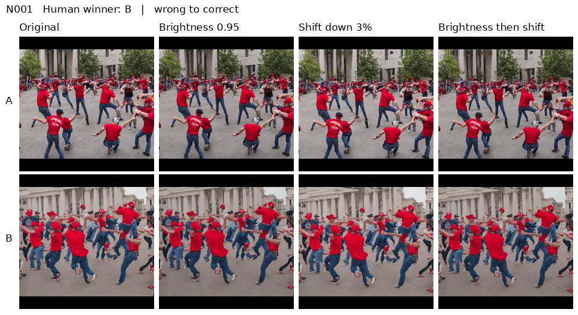
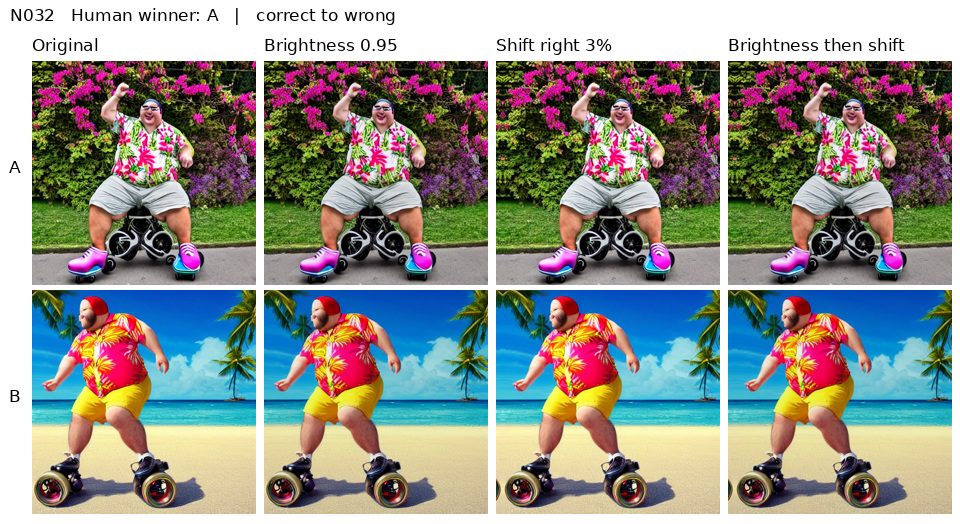

# 把亮度和平移叠在一张图上，能改变偏好排序吗？

**模型响应变了。** 在 256 对图的 2,048 个「图对 × 参数」比较中，1,927 个出现非零交互，两种策略分差之差的绝对值中位数为 0.00036621。
**严格换赢家发生了 13 次，涉及 12 对图。** 另有 7 次进入或离开同分。合计 14 对图至少一次改变判定。
**相对人工偏好，叠加平均净增 0.125 对严格选对。** 选对率差为 +0.049 个百分点，按图对配对 bootstrap 的 95% 区间为 [−0.342, +0.439] 个百分点。这批开发数据尚难确定收益方向。

### 同一张图，两次评分怎么用

每对沿用 ImageRewardDB validation 的原提示词 P0 和人工赢家。B 为 0.95 或 1.05 倍亮度，T 为四个方向之一的 3% 整像素平移。分开策略平均 B、T 两个视图的评分；叠加策略平均原图 O 和先调亮度后平移的 BT 评分。每套参数在 A/B 上完全相同，先判胜负，再均匀平均八套结果。小数对数表示均匀选一套参数时的期望。

| 每图使用的视图 | 严格选对（对） | 严格选错（对） | 同分（对） | 严格选对率 |
|---|---:|---:|---:|---:|
| O | 175 | 81 | 0 | 68.359% |
| O、B | 173.500 | 82.000 | 0.500 | 67.773% |
| O、T | 176.250 | 79.250 | 0.500 | 68.848% |
| B、T 分开 | 175.625 | 79.875 | 0.500 | 68.604% |
| O、BT 叠加 | 175.750 | 79.625 | 0.625 | 68.652% |

| 分开 → 叠加（图对 × 参数次数） | 选对 | 选错 | 同分 |
|---|---:|---:|---:|
| 原先选对 | 1,398 | 5 | 2 |
| 原先选错 | 8 | 629 | 2 |
| 原先同分 | 0 | 3 | 1 |

叠加纠正 8 次、改错 5 次，另有 2 次从选对变同分，严格选对净增 1 次，即 1/8 个期望图对。按 256 个完整提示词图对重采样 10,000 次，每次保留全部搭配。

### 分差改变了多少

用人工赢家减另一张图的评分定义有向分差。交互量 I = m_BT − m_T − m_B + m_O，逐搭配验证「叠加分差 − 分开分差 = I/2」，最大残差为零。交互绝对值中位数为 0.00073242，四分位区间 [0.00024414, 0.00134277]。相对原图领先幅度，交互绝对值的中位数为 3.90%（四分位 1.44%–9.68%），实际策略分差差异再减半。原图无同分。

HPS v2.1 原生 FP16 输出转 float64 计算。以该搭配两侧八个原始分数中最大的相邻 FP16 间距为参照，间距为 0.00012207 或 0.00024414；426/2,048 个交互的绝对值在一步以内，其中 121 个恰为零。这些小值的更细幅度受输出精度限制。

### 两个实际换赢家的搭配

按冻结顺序取首次严格纠正和首次严格改错。图中两行为 A/B，四列为 O、B、T、BT。所有 16 张展示图都逐张通过模型输入张量哈希核对。

| 图对 | 人工赢家 | 参数 | 分开有向分差及赢家 | 叠加有向分差及赢家 |
|---|---|---|---|---|
| N001，小丑戴红帽在政府建筑旁跳舞 | B | 0.95、下移 3% | −0.00024414，A | +0.00024414，B |
| N032，穿夏威夷衬衫和轮滑鞋的男子 | A | 0.95、右移 3% | +0.00012207，A | −0.00048828，B |

Asus 物理 2 号 RTX 4090 完成 4,124 次新视觉评分，其中 4,096 次为复合视图。历史缓存提供 3,556 条，正式阶段复用了冒烟阶段的 60 条。两阶段合计墙钟 182.81 秒，累计逐次新视觉评分及标量回传 74.82 秒。完整表共 7,680 个唯一键。[评分与复现命令](README.md)
