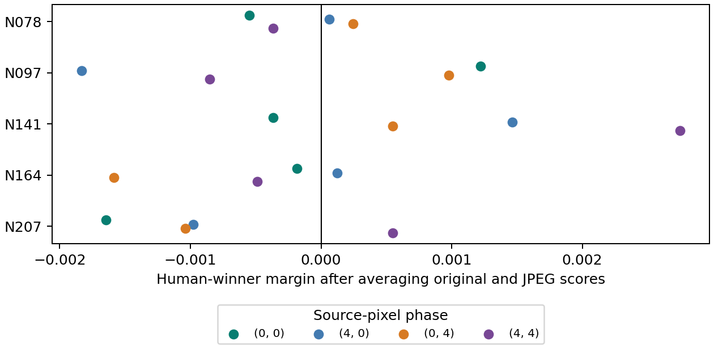

# JPEG 编码网格移动四个像素，会改变偏好选择吗？

保持物体坐标、画布和 JPEG 质量 85 不变，只改变源图相对编码网格的起点。**256 对图的 JPEG 分差都随相位变化，其中 5 对跨过了选图边界。** 四相位均匀抽一套，与原图等权评分，期望选对数从 175 到 174.25，净差 **−0.293 个百分点**（按图对配对的 95% 区间 [−1.758, +1.172]）。差异能改变个案，本批未显示整体选对率提高。

| 每图策略 | 期望选对 / 错 / 同分 | 相对原图纠正 / 改错 | 严格选对率净差 |
|---|---:|---:|---:|
| 原图 | 175 / 81 / 0 | — | — |
| 原图＋随机 JPEG 相位 | 174.25 / 81.75 / 0 | 2.00 / 2.75 | −0.293 个百分点 |
| 原图＋冻结高斯半径 | 175 / 81 / 0 | 0 / 0 | 0.000 个百分点 [0, 0] |

四相位**单视图**有向分差极差的中位数为 0.003418（四分位 0.001999–0.005371）；与原图平均后极差减半。四个相位都选对 172 对，均选错 79 对，余下 5 对随相位严格换赢家，无同分。原图选错的 N020 在四相位都获纠正，N078、N164、N207 只在 2/4、1/4、1/4 套下纠正。原图选对的 N097、N141 分别在 2/4、1/4 套下改错。图中每种颜色代表实际可以部署的一套相位。

**正反例。** 在相位 (0,0)，N020 从原图 −0.000366 变为 +0.005432；N083 从 +0.000977 变为 −0.004150。前者四套都纠正，后者四套都改错。N078 则仅在 (4,0) 和 (0,4) 改对。所有分差均按人工赢家减另一候选定向。

**高斯强度匹配未达到预设标准。** 旧 64 对共 128 张图，按每图 JPEG 四相位平均值校准。冻结网格最接近的高斯半径为 0.1 个源像素；能量相对变化的平均绝对匹配误差为 0.002796，容限为 0.000699。JPEG 使 66 张图的有效画面亮度差分能量上升、62 张下降。这解释了为何很轻的高斯也难匹配。

| 旧 128 张图，每图一个观测 | 差分能量相对变化，中位数 [Q1, Q3] | 有效 RGB 像素 MSE，中位数 [Q1, Q3] |
|---|---:|---:|
| JPEG（四相位平均） | +0.0125% [−0.2085%, +0.1335%] | 8.90×10⁻⁶ [5.44×10⁻⁶, 1.57×10⁻⁵] |
| GaussianBlur(0.1) | 0% [−0.00055%, 0%] | 9.81×10⁻¹² [0, 2.11×10⁻¹⁰] |

主批的四种无编码填充裁回都还原原图，同一张图经四种填充做高斯也逐像素相等。JPEG 网格起点对具体决策的作用可以单独识别；高斯没有纠正案例，且两方法强度匹配失败，现有结果无法判定共同细节损失解释了多少。此次全用 4:4:4，历史 4:2:0 分数未参与比较。
