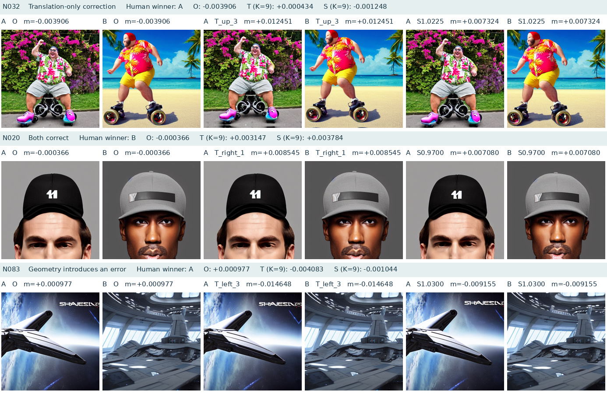

# 轻微平移与中心缩放能纠正同一批图对吗？

① 在原来的七对上，缩放在 K=3、5、9 下分别能纠正 **5、5、1 对**（至少一套严格选对、且本轮原图选错）。

② 在完整 256 对上，K=9 纯平移独有 **4 对**，纯缩放独有 **1 对**，共有 **2 对**。两种纯策略各只有一套，至少一次与至少 25% 的覆盖完全相同。

③ K=9 混合相对纯平移、纯缩放的严格选对率差分别为 **-0.688 [-1.615, -0.022]**、**+0.484 [-0.695, +1.736]** 个百分点（95% 配对区间）。在这批开发提示词上，均匀混合的严格选对率低于纯平移，相对纯缩放的区间跨零。

## 七个历史案例

这 256 对沿用 P3 的开发样本。七例的入选依据来自 P2/translation 的三次评分历史缓存：原图严格选错，BB、CC、BC 没有搭配选对，BT 至少一套选对。我们在新缩放评分前从双方原始分数重新枚举并冻结。历史 B、C 各用 0.90、0.95、1.05、1.10，T 用四方向 3%；另存 P3 在 L4 上的八方向预算结果供对照。

| 图对 | 人工赢家 | 旧 BT /16 | 旧 TT /6 | T，K=3 | S，K=3 | T，K=5 | S，K=5 | T，K=9 | S，K=9 |
|---|---|---|---|---|---|---|---|---|---|
| N030 | B | 3 | 2 | 8/28 | 0/28 | 14/70 | 0/70 | 0/1 | 0/1 |
| N032 | A | 4 | 4 | 10/28 | 6/28 | 35/70 | 17/70 | 1/1 | 0/1 |
| N088 | A | 2 | 2 | 4/28 | 5/28 | 4/70 | 11/70 | 0/1 | 0/1 |
| N147 | A | 1 | 1 | 1/28 | 0/28 | 0/70 | 0/70 | 0/1 | 0/1 |
| N171 | B | 3 | 6 | 28/28 | 21/28 | 70/70 | 70/70 | 1/1 | 1/1 |
| N207 | A | 14 | 6 | 20/28 | 10/28 | 63/70 | 17/70 | 1/1 | 0/1 |
| N217 | A | 12 | 4 | 17/28 | 2/28 | 62/70 | 3/70 | 1/1 | 0/1 |

K=3 时，新平移池未纠正的历史案例为 0 对。

K=5 时，新平移池未纠正的历史案例为 N147。

K=9 时，新平移池未纠正的历史案例为 N030、N088、N147。

历史前向为 CUDA AMP FP16，本次原图和四种增强均以同一生产配置重算。256 对中原图判定（正／零／负）有 0 对不同。用本轮分数只取历史四个 3% 方向，三次纯平移在七例中的命中数如下，可直接检查推理数值与换池的影响。

| 图对 | 历史 TT /6 | 同四方向本轮 TT /6 | 本轮同分 /6 |
|---|---|---|---|
| N030 | 2 | 2 | 0 |
| N032 | 4 | 4 | 0 |
| N088 | 2 | 2 | 0 |
| N147 | 1 | 1 | 0 |
| N171 | 6 | 6 | 0 |
| N207 | 6 | 6 | 0 |
| N217 | 4 | 4 | 1 |

再单看原图＋一个几何版本，下面列出能直接使原始错例选对的方向或倍率。某个版本也可能只在搭配里有用；[完整参与次数](dev256/full_seven_parameters.csv)记录每个版本进入成功组合的次数、版本本身的分差和相对原图的位移方向。

| 图对 | 平移方向／百分比 | 缩放倍率 |
|---|---|---|
| N030 | T_left_3 T_down_1 T_down_3 | 无 |
| N032 | T_up_3 | S1.0150 S1.0225 S1.0300 |
| N088 | T_down_3 | S0.9850 |
| N147 | T_right_3 | 无 |
| N171 | T_left_1 T_left_3 T_right_1 T_right_3 T_up_3 T_down_3 | S0.9700 S0.9775 S1.0150 S1.0225 S1.0300 |
| N207 | T_left_3 T_right_3 T_up_3 T_down_3 | S1.0225 |
| N217 | T_left_3 T_right_1 T_right_3 T_up_3 | S0.9925 |

三次预算给出另一种可读的方向诊断：固定其中一个增强版本，另一个在其余七档中均匀选择。下表列出与最多成功搭配相伴的版本；并列全部列出。该频率由两档与原图共同决定。

| 图对 | 平移最高条件频率 | 缩放最高条件频率 |
|---|---|---|
| N030 | T_down_1（5/7） | 无（0/7） |
| N032 | T_up_3（7/7） | S1.0075、S1.0150、S1.0225、S1.0300（3/7） |
| N088 | T_down_3（4/7） | S0.9850（4/7） |
| N147 | T_left_3、T_right_3（1/7） | 无（0/7） |
| N171 | T_left_1、T_left_3、T_right_1、T_right_3、T_up_1、T_up_3、T_down_1、T_down_3（7/7） | S0.9775（7/7） |
| N207 | T_left_3、T_right_3（7/7） | S0.9700、S1.0075、S1.0150、S1.0225、S1.0300（4/7） |
| N217 | T_right_3（7/7） | S0.9925（2/7） |

## 完整 256 对的同预算比较

原图基线严格选对 175 对、选错 81 对、同分 0 对。B、C、T、S 分别指亮度、对比度、平移、中心缩放，TS 的两个变换分别作用于原图。每一套从八个版本中无放回取样，A/B 共用参数。每张图都含一次原图，图像分数等权取均值，再按人工赢家相对另一张图的分差符号判定。下表的纠正、改错与同分为均匀取一套时的期望对数。

| K | 策略 | 搭配数 | 严格选对率 | 错→对 | 对→错 | 对→同分 | 错→同分 | 原同分→对／错／同分 |
|---|---|---|---|---|---|---|---|---|
| 3 | B | 28 | 67.997% | 0.250 | 0.893 | 0.286 | 0.179 | 0.000/0.000/0.000 |
| 3 | C | 28 | 68.206% | 0.357 | 0.714 | 0.036 | 0.143 | 0.000/0.000/0.000 |
| 3 | T | 28 | 68.890% | 5.357 | 3.893 | 0.107 | 0.036 | 0.000/0.000/0.000 |
| 3 | S | 28 | 68.192% | 3.107 | 3.429 | 0.107 | 0.036 | 0.000/0.000/0.000 |
| 3 | TS | 64 | 68.555% | 4.328 | 3.781 | 0.047 | 0.078 | 0.000/0.000/0.000 |
| 5 | B | 70 | 67.946% | 0.129 | 1.129 | 0.057 | 0.071 | 0.000/0.000/0.000 |
| 5 | C | 70 | 68.075% | 0.157 | 0.829 | 0.057 | 0.029 | 0.000/0.000/0.000 |
| 5 | T | 70 | 68.823% | 5.629 | 4.386 | 0.057 | 0.043 | 0.000/0.000/0.000 |
| 5 | S | 70 | 68.108% | 3.171 | 3.757 | 0.057 | 0.043 | 0.000/0.000/0.000 |
| 5 | TS | 784 | 68.488% | 4.489 | 4.103 | 0.055 | 0.054 | 0.000/0.000/0.000 |
| 9 | B | 1 | 67.969% | 0.000 | 1.000 | 0.000 | 0.000 | 0.000/0.000/0.000 |
| 9 | C | 1 | 67.969% | 0.000 | 1.000 | 0.000 | 0.000 | 0.000/0.000/0.000 |
| 9 | T | 1 | 69.141% | 6.000 | 4.000 | 0.000 | 0.000 | 0.000/0.000/0.000 |
| 9 | S | 1 | 67.969% | 3.000 | 4.000 | 0.000 | 0.000 | 0.000/0.000/0.000 |
| 9 | TS | 4900 | 68.453% | 4.491 | 4.230 | 0.022 | 0.035 | 0.000/0.000/0.000 |

| K | 左 − 右 | 搭配数 左 / 右 | 严格选对率差 [95% 区间]，百分点 |
|---|---|---|---|
| 3 | T − S | 28 / 28 | +0.698 [-0.098, +1.604] |
| 3 | TS − T | 64 / 28 | -0.335 [-0.822, +0.087] |
| 3 | TS − S | 64 / 28 | +0.363 [-0.081, +0.868] |
| 3 | B − C | 28 / 28 | -0.209 [-0.460, +0.000] |
| 5 | T − S | 70 / 70 | +0.714 [-0.312, +1.892] |
| 5 | TS − T | 784 / 70 | -0.334 [-0.856, +0.130] |
| 5 | TS − S | 784 / 70 | +0.380 [-0.214, +1.103] |
| 5 | B − C | 70 / 70 | -0.128 [-0.424, +0.078] |
| 9 | T − S | 1 / 1 | +1.172 [-0.391, +3.125] |
| 9 | TS − T | 4900 / 1 | -0.688 [-1.615, -0.022] |
| 9 | TS − S | 4900 / 1 | +0.484 [-0.695, +1.736] |
| 9 | B − C | 1 / 1 | +0.000 [+0.000, +0.000] |

整对提示词 bootstrap 10,000 次，固定种子 20261128，区间为逐比较描述性区间。对于每个图对，每个版本在均匀组合中等概率入选。混合均值等于两纯均值的一半之和，因为两族分配的槽位相等且原图权重相同。主批全部预算的最大绝对核验残差为 2.78e-17 HPS 分。

以下只取原始错例；每格为左独有／共有／右独有。[有向覆盖明细](dev256/full_coverage.csv)保留全部 ID。

| K | 左 / 右 | 两侧搭配总数 | 至少一次 | 至少 25% |
|---|---|---|---|---|
| 3 | T / S | 28 / 28 | 7/9/1 | 4/3/1 |
| 3 | TS / T | 64 / 28 | 2/15/1 | 0/5/2 |
| 3 | TS / S | 64 / 28 | 7/10/0 | 2/3/1 |
| 3 | B / C | 28 / 28 | 1/3/1 | 0/0/0 |
| 5 | T / S | 70 / 70 | 5/7/2 | 4/2/1 |
| 5 | TS / T | 784 / 70 | 5/12/0 | 0/5/1 |
| 5 | TS / S | 784 / 70 | 8/9/0 | 3/2/1 |
| 5 | B / C | 70 / 70 | 1/1/2 | 0/0/0 |
| 9 | T / S | 1 / 1 | 4/2/1 | 4/2/1 |
| 9 | TS / T | 4900 / 1 | 7/6/0 | 0/5/1 |
| 9 | TS / S | 4900 / 1 | 10/3/0 | 3/2/1 |
| 9 | B / C | 1 / 1 | 0/0/0 | 0/0/0 |

稳定事件按至少 25% 的搭配严格纠正或严格改错，下列 ID 只统计提示词一次。

| K | 方法 | 稳定纠正 | 稳定改错 |
|---|---|---|---|
| 3 | T | N020 N030 N032 N171 N207 N217 N231 | N083 N097 N107 N141 N223 |
| 3 | S | N020 N045 N171 N207 | N083 N097 N141 N223 N241 |
| 5 | T | N020 N032 N171 N207 N217 N231 | N083 N097 N107 N141 N223 |
| 5 | S | N020 N045 N171 | N083 N097 N141 N223 |
| 9 | T | N020 N032 N171 N207 N217 N231 | N083 N097 N141 N223 |
| 9 | S | N020 N045 N171 | N083 N097 N141 N223 |

主预算下，平移独有纠正 N032 N207 N217 N231，缩放独有纠正 N045，共有纠正 N020 N171。
这两种纯策略把同一批原本选对的图改错：N083 N097 N141 N223。

## 用旧 64 对检查扰动强度

校准集和开发集分别统计。每个版本先计算 64 对的绝对分差位移中位数，以及 128 张官方模型输入的平均像素绝对变化的中位数（反归一化后 0–255 单位）。只在两族分差位移中位数的交集内，一对一匹配尽可能多的版本，并最小化总绝对距离。随后冻结匹配文件再开始 256 对打分。

| 匹配版本 T / S | 64 对位移 T / S | 64 对像素变化 T / S | 256 对位移 T / S | 256 对像素变化 T / S |
|---|---|---|---|---|
| T_left_1 / S0.9850 | 0.00269 / 0.00275 | 11.52688 / 7.44087 | 0.00281 / 0.00317 | 11.45922 / 7.69348 |
| T_down_1 / S1.0150 | 0.00317 / 0.00281 | 10.41583 / 7.41611 | 0.00330 / 0.00269 | 11.32947 / 7.67261 |
| T_right_1 / S0.9775 | 0.00323 / 0.00311 | 11.50991 / 9.81618 | 0.00305 / 0.00397 | 11.43517 / 10.20225 |
| T_up_1 / S1.0225 | 0.00342 / 0.00330 | 10.40004 / 9.60192 | 0.00342 / 0.00330 | 11.37639 / 10.21289 |
| T_left_3 / S1.0300 | 0.00433 / 0.00452 | 20.35919 / 11.72888 | 0.00452 / 0.00366 | 20.98661 / 12.18684 |

共同分差位移范围下端 0.002686、上端 0.004517，保留 5 对版本。旧 64 对完整池 K=9 严格选对率为 B 67.188%、C 67.188%、T 65.625%、S 65.625%、TS 65.485%。

| 匹配池 K | 比较 | 严格选对率差 [95% 区间]，百分点 |
|---|---|---|
| 2 | T − S | +0.391 [-0.625, +1.406] |
| 3 | T − S | +0.312 [-0.547, +1.211] |
| 3 | TS − T | -0.062 [-0.672, +0.578] |
| 3 | TS − S | +0.250 [-0.195, +0.719] |
| 5 | T − S | +0.312 [-0.859, +1.562] |
| 5 | TS − T | -0.340 [-1.149, +0.355] |
| 5 | TS − S | -0.027 [-0.641, +0.547] |

在开发集相同的 K=5 下，T−S 严格选对率差从完整池的 +0.714 [-0.312, +1.892] 变为匹配池的 +0.312 [-0.859, +1.562] 个百分点。
匹配池 K=5 的稳定纠正分别有平移独有 3 对、缩放独有 2 对、两者共有 3 对。
开发集匹配版本之间的像素变化中位数差的绝对值，跨匹配取中位为 3.657/255。
匹配约束作用于这批图的典型分差位移。像素变化和逐图位移仍有差异，无法把平移多纠正的全部案例归因于算子类型。本次匹配池每族少于八档，K=9 的纯策略只能引用完整池结果。

## 模型实际看到的案例

类别按 K=9 纯策略严格决策选择，每类优先取编号最小且尚未展示的图对。图中每种变换均并列 A/B，展示选定方法中朝相应判定移动最多的单版本。K=9 的最终分差另列；单个版本只贡献八个增强分数之一。所有展示输入均与评分记录的张量哈希逐张匹配。

| 类别 | 实际例数 | 图对／人工赢家 | 原图分差 | 单个展示视图的有向分差 | 全池 T9 / S9 |
|---|---|---|---|---|---|
| 仅平移纠正 | 4 | N032 A | -0.00390625 | O -0.003906，T_up_3 +0.012451，S1.0225 +0.007324 | 0.00043402777777777775 / -0.001247829861111111 |
| 两者均纠正 | 2 | N020 B | -0.0003662109375 | O -0.000366，T_right_1 +0.008545，S0.9700 +0.007080 | 0.003146701388888889 / 0.0037841796875 |
| 几何扰动改错 | 4 | N083 A | 0.0009765625 | O +0.000977，T_left_3 -0.014648，S1.0300 -0.009155 | -0.004082573784722222 / -0.0010443793402777778 |

## 运行与完整性

| 提示词 | 原始分数 | 新增图像前向 | 断点命中 | 重复张量复用 | 外部缓存命中 | 各工作进程图像前向秒之和 |
|---|---|---|---|---|---|---|
| 64 | 4224 | 4224 | 132 | 0 | 0 | 77.7 |
| 256 | 16896 | 16896 | 132 | 0 | 0 | 307.1 |

生产流程实际墙钟 703.7 秒，设备 cuda，并行进程 1，图像批大小 1。各批分别用原图标签；平局保留在分母中。这里是对既有开发提示词的观察。

正式结果在 Asus4090x8 的物理 2 号卡 NVIDIA GeForce RTX 4090 上完成，驱动 580.159.04，PyTorch 2.5.1+cu124，CUDA autocast FP16，官方 HPS v2.1 验证预处理。GPU 合计新图像前向 21,120 次，断点复用 264 条。上表最后一列只计图像前向。生产墙钟另外包含权重校验、模型加载、两批冒烟、强度冻结与离线枚举。

两对冒烟在 CPU 与 Asus 上的 132 个官方输入张量哈希全部相同。与历史缓存可按 RGB 逐像素比对的 36 项中，31 项分数相同，最大绝对差 0.000244140625。所有正式评分都在 Asus 上产生。

另将原始分数无损换算为整数，独立核验 1,966,080 个图对×策略搭配的严格决策，差异 0 项。
逐批跨图像检查输入哈希。64 对中，4,224 条评分对应 4,224 个不同图像张量，4,224 个不同的张量与提示词 token 组合。256 对中，16,896 条评分对应 16,896 个不同图像张量，16,896 个不同的张量与提示词 token 组合。

切换到 Asus 前，另一台机器的 CPU 探查留有 64 对校准、189 对开发数据的完整检查点，以及单独的 132 次单张冒烟。其 FP32 分数与耗时单独留档。停止时在途前向未逐次记账；上述正式 GPU 统计完整。
