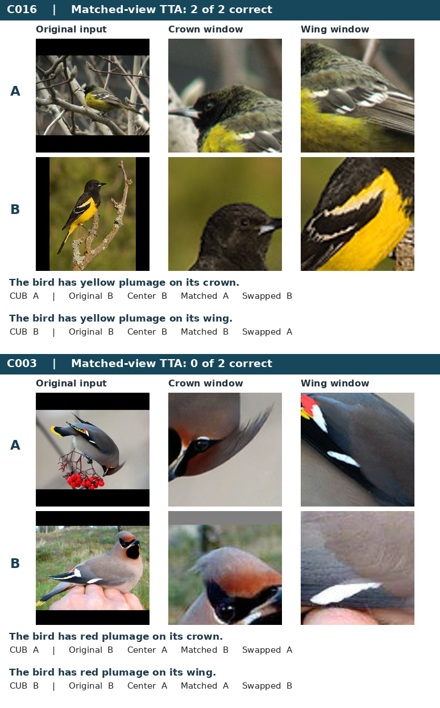

# 问鸟冠还是问翅膀，第二个视图该看哪里？

**在这 96 对同种鸟照片上，换问题时，严格选对数较高的裁块也跟着换了。** 问鸟冠时看冠窗多对 3 题，问翅膀时看翅窗只多对 1 题。对应部位共选对 **99/192**，交换部位为 **95/192**，相差 **+2.08 个百分点**（按物种整簇 bootstrap 的 95% 区间 **−8.42 至 +13.16**）。对应部位的点估计也高于原图和中心窗，三个区间都跨零，尚不能据此判断按题选窗有稳定优势。

| 每格为严格选对数 / 全部图对 | 原图＋鸟冠窗 | 原图＋翅膀窗 |
|---|---:|---:|
| 鸟冠题 | **52/96** | 49/96 |
| 翅膀题 | 46/96 | **47/96** |

**这 4 题的净差从哪里来？** 只看原图时鸟冠题选对 50 题、翅膀题 47 题。相对原图，选对应窗合计多对 2 题，均来自鸟冠题；交换窗合计少对 2 题，两种问题各少 1 题。翅膀题换回对应窗后恰好回到原图水平。逐题直接把交换窗换成对应窗，27 道原先选错的题被纠正，同时有 23 道原先选对的题被改错，另有 1 道从错变为同分。[四格明细](four_cells.csv) · [逐题判定](questions.csv)

| 策略 | 严格选对 / 192 | 选错 | 同分 | 两题都对 / 96 | 仅一题对 | 两题均未严格选对 |
|---|---:|---:|---:|---:|---:|---:|
| 原图 | 97（50.52%） | 95 | 0 | 2 | 93 | 1 |
| 原图＋中心窗 | 89（46.35%） | 102 | 1 | 2 | 85 | 9 |
| 原图＋对应部位窗 | **99（51.56%）** | 92 | 1 | **14** | 71 | 11 |
| 原图＋交换部位窗 | 95（49.48%） | 97 | 0 | 13 | 69 | 14 |

对应部位相对原图**纠正 25 题、改错 23 题**，另有 1 道错题变同分，严格选对率差为 +1.04 个百分点（95% 区间 −4.74 至 +6.84）。相对同预算中心窗，**纠正 29 题、改错 19 题**，另有 1 道错题变同分、1 道同分变错，差为 +5.21 个百分点（−1.04 至 +11.58）。原图仅 2 对两题都对，加入对应窗后增至 14 对，但两题均未选对也从 1 对增至 11 对。两题各自比较 A、B，模型可连续选同一候选。[全部转移](transitions.csv) · [物种簇区间](contrasts.csv)

**高确定度子集。** 在四项属性均为 definitely 的 29 对上，鸟冠题看冠窗和翅窗分别选对 **17、15** 题，与全体方向一致；翅膀题看冠窗和翅窗均为 **12** 题，全体中 1 题的微小领先在子集中消失。两题合计，对应窗和原图均选对 29/58。该子集只作敏感性检查。[分组结果](strategy_summary.csv)

**两个真实图对。** C016 问黄色时，原图两题都选 B；加对应窗后分别选 A、B，两题均符合属性标签。C003 问红色时，对应窗分别选 B、A，两题都与标签相反；A 的原图中可见红色果实，B 的翅窗也包含托鸟的手。图中从左到右为原图、冠窗和翅窗，图下注明两句提示、CUB 标签和各策略实际选择。

**适用范围与核验。** 76 个物种、9 种颜色、192 张不同原图；384 项颜色标签和所有点位、可见翅侧已与官方标注核对。双视图预算为每候选每题两次 HPS 评分，使用已有部位关键点，定位成本另计。192 张中有 135 张的冠、翅方窗重叠（涉及 88 对）；28 个局部窗需补边（涉及 26 对）。这些窗也包含周边羽毛和背景。每个物种为一个重采样簇，两题及所有策略一起重采 10,000 次，种子为 20261128。Asus 物理 3 号 RTX 4090 上，HPS v2.1 产生 768 个不同视觉输入、1,536 条唯一 FP16 原始评分；正式阶段复用冒烟的 32 条，合计评分墙钟 **63.49 秒**，含两次加载。独立核验与随包脚本的 768 个有向分差和三个区间全部一致。[复现命令与冒烟图](README.md) · [原始评分](scores.csv) · [几何记录](geometry.csv) · [核验结果](validation.json)
