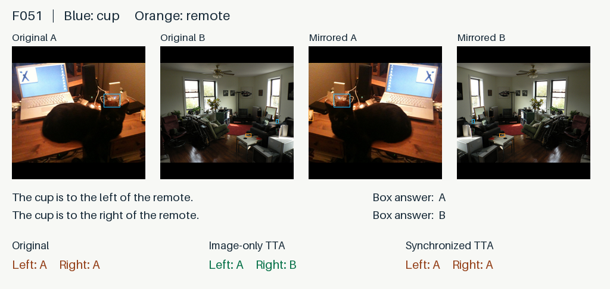

# 翻图时交换 left/right，能让 HPS 更会判断左右吗？

① 以同一对照片的左右两题都严格答对为准，只翻图使原有成功丢失 **0 对**，新增 **1 对**，成功数从 1/64 变为 2/64。

② 相对只翻图，同步交换方向词救回 **0 对**，又使 **2 对**失去双题全对，主指标相差 **-3.125 个百分点（95% 区间 [-7.812, +0.000]）**。

③ 与原图相比，同步策略的双题全对率差为 **-1.562 个百分点（95% 区间 [-4.688, +0.000]）**。本批未观察到净收益。

## 三种策略在同一批图上的选择

每道题在两张照片间选一张，真值来自 COCO 实例框。交换方向词会把正确候选从 A 换成 B 或从 B 换成 A。主指标的分母是 64 个完整图对，单题指标的分母是 128 题。下表的“仍选同图”指两道题都严格选择了同一个候选。

| 评分策略 | 双题全对／图对 | 单题严格选对 | 单题严格选错 | 单题同分 | 换方向仍选同图 |
|---|---|---|---|---|---|
| 原图 | 1/64 (1.56%) | 65/128 (50.78%) | 63/128 | 0/128 (0.00%) | 63/64 (98.44%) |
| 只翻图 | 2/64 (3.12%) | 66/128 (51.56%) | 62/128 | 0/128 (0.00%) | 62/64 (96.88%) |
| 图文同步 | 0/64 (0.00%) | 64/128 (50.00%) | 64/128 | 0/128 (0.00%) | 64/64 (100.00%) |

双题均选对的 ID 按原图、只翻图、图文同步依次为 **F060**、**F051、F060**、**无**。同步策略在 64/64 对中两次都选了同一张照片。由于左右两题答案相反，在这些图对上会恰好答对一题。

方向词改变了 125/128 张原图、127/128 张镜像图的单图分数。模型对用词有数值响应，但该响应很少足以改变两张自然照片的相对排序。下表把每道题的纠正、改错单独计数。

| 策略变化 | 单题 错→对 | 单题 对→错 |
|---|---|---|
| 原图 → 只翻图 | 4 | 3 |
| 只翻图 → 图文同步 | 0 | 2 |
| 原图 → 图文同步 | 3 | 4 |

区间使用种子 42 的 10,000 次配对 bootstrap。每次抽取完整图对，保留两道题和三种策略。稀少的成功或失败事件限制了对总体差异的判断。[各指标差值与区间](comparisons.csv) · [逐对选择与分差](pair_results.csv)

## 选图与评分

COCO 2017 validation 的 404 种类别组合有两个方向的合格照片。固定种子 42，打乱类别组合后轮流取对，打乱同组照片顺序以及主体 X 和 A/B 的分配。本批最终为 64 对、128 张不同照片、64 种不同类别组合。每张图的两个目标类别分别只有一个标注实例且均为非 crowd。同一目标类别带额外 crowd 标注的照片也剔除。每对左右提示只替换一个方向词。照片和两个物体的先后顺序由标注确定，抽样在模型评分前完成。

实际 HPS 验证预处理将长边缩放至 224 并居中补边。框按实际整数缩放尺寸分别映射横纵轴，裁到内容区后可见面积至少 80%，两框在水平方向不重叠，中心横距至少为内容区宽度的 20%。逐图用常量画布经官方 resize 测出内容区，核对镜像前后左右标签互换。对应的英文原句、框坐标、文件哈希与带框预览均已保存。[冻结清单](pairs.csv) · [照片和框](images.csv) · [带框预览](box_previews.html)

原图和从 RGB 原图生成的水平镜像各算左、右两条提示。原图策略直接比较两张原图的分数。只翻图策略平均当前题的原图和镜像分数。同步策略平均当前题的原图分数和相反方向题的镜像分数。所有策略用 A 减 B 的分差判定，原生 FP16 分数转 float64 求和，严格为零记为同分。这里评估的是框定义的空间关系，COCO 标注没有评价照片质量或审美偏好。

## 用自身镜像检查实现

固定种子从 128 张已评分照片中不放回抽 8 张，用每张照片的自身镜像作候选 B。任一提示 q 下，两侧只翻图的结果分别是 (原图分＋镜像分)/2 与 (镜像分＋原图分)/2。缓存重算的 **8 对 × 2 题全部精确同分**，最大绝对分差为 0。主实验的两个候选来自不同照片，所以这个恒等式只适用于单列检查。[16 项检查](mirror_check.csv)

## 案例

“原图双题全对而只翻图失败”共 0 对，“同步改词后恢复这些原有成功”共 0 对。同步策略未获得双题全对的有 64 对。案例按这三类依次覆盖，失败类优先展示只翻图能答对两题的图对，再按 ID 取首个可发布镜像的例子。

蓝框标主体，橙框标参照物。框仅用于读图，评分时输入没有标记。

**F051 · cup 与 remote。** 左题答案 A，右题答案 B。下列分差均为 A−B，正值选择 A。

| 实际提示 | 原图 选择／分差 | 只翻图 选择／分差 | 图文同步 选择／分差 |
|---|---|---|---|
| The cup is to the left of the remote. | A ／ +0.00842285 | A ／ +0.00531006 | A ／ +0.00250244 |
| The cup is to the right of the remote. | A ／ +0.00317383 | B ／ -0.00012207 | A ／ +0.00268555 |

[案例照片署名与许可](photo_credits.md)

## 适用范围与运行记录

结论限于这批自然照片、冻结的提示句式和 HPS v2.1。两张自然照片在场景与外观上也有差异，结果能检验方向词能否改变模型的最终选择，尚不足以辨别模型在依据哪些视觉特征打分。实例框能确定标注目标的相对位置，目标在 224 像素输入中的大小和辨识难度仍有差别。

正式运行使用 Asus 的 NVIDIA RTX 4090、PyTorch 2.5.1+cu124、HPS v2.1 和 CUDA autocast FP16。先验证两对的 token、翻转方向、补边以及赢家映射，再完成全体。首次运行得到 512 条图文分数，共 256 次图像编码，断点命中 0 条。评分墙钟 29.1 秒，计入 GPU 图像前向及两次相似度计算的时间合计 4.8 秒。[原始评分](scores.csv) · [冒烟检查](smoke.json) · [复跑方法](README.md)
