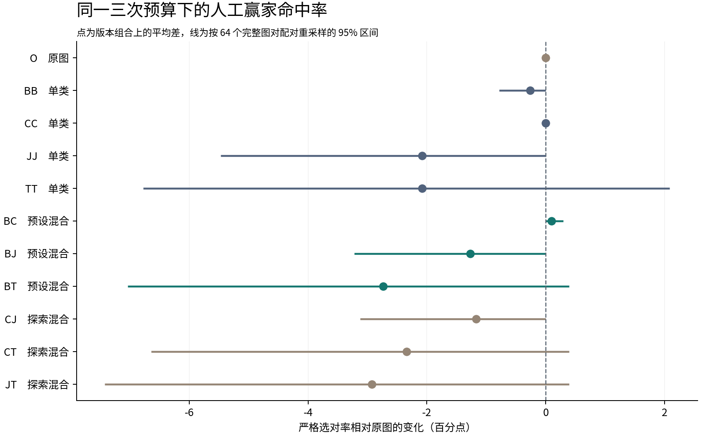
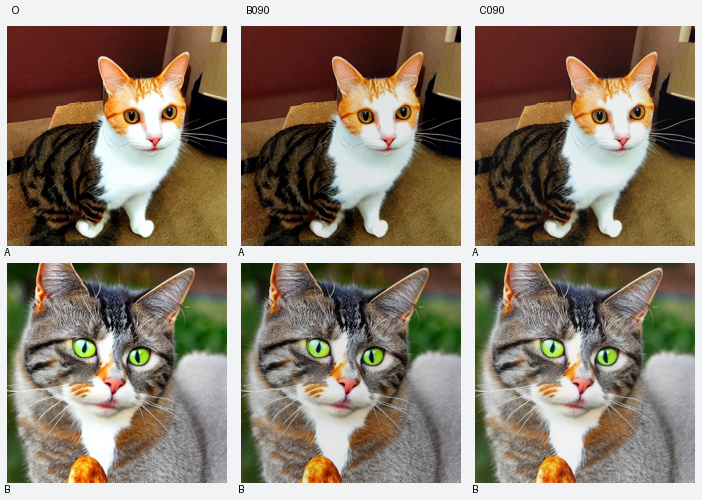
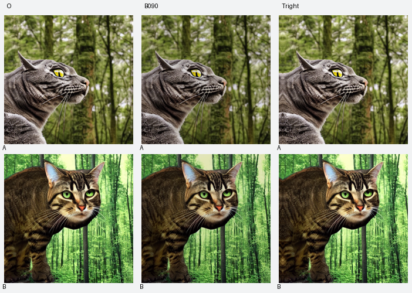
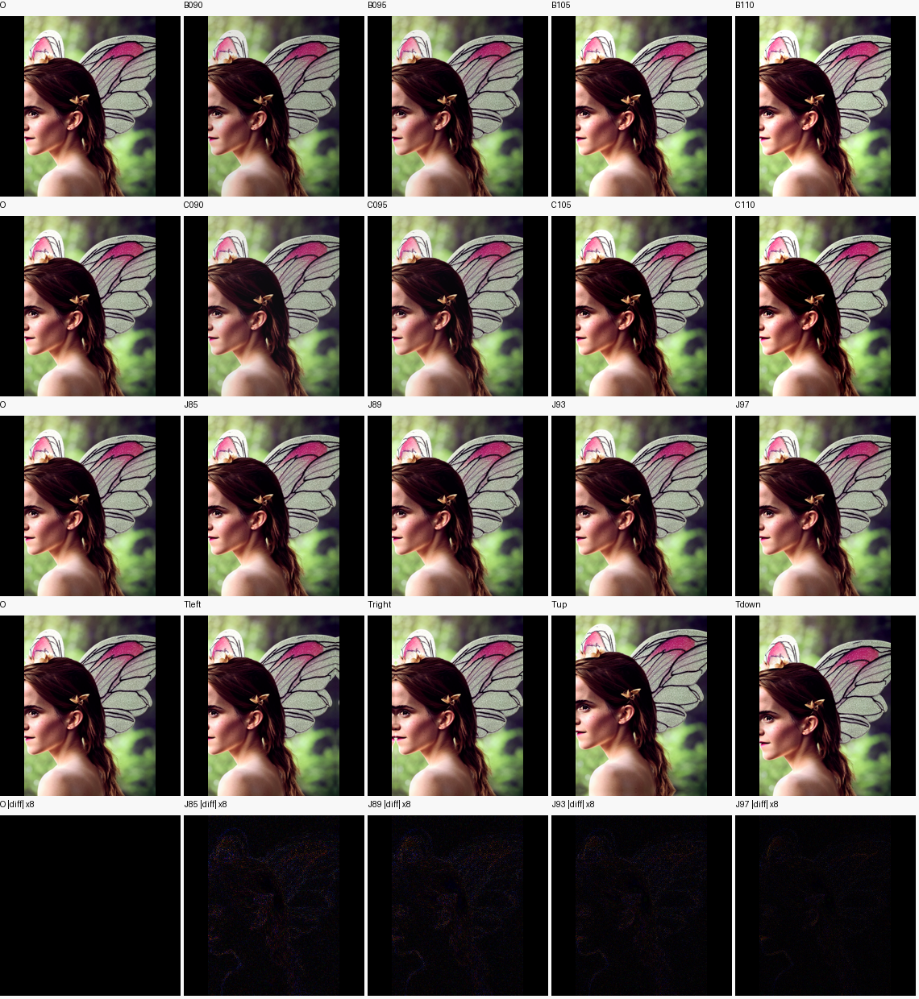

# P2 · 固定三次评分预算的增强互补性实验

① **平移增加了一个光度策略未纠正的图对，JPEG 没有显示独立的新增纠正。** 003 的原图选择 A，人工赢家为 B。BB、CC、BC 和 JJ、BJ、CJ 在所有版本下都未纠正；TT 有 4/6 种组合纠正，BT、CT、JT 各有 4/16 种。就这批参数看，单用平移已经能找到这对图。

② **这些新增纠正没有抵过新增改错。** 限定在光度策略从未出现相应事件的图对，BT 新增期望纠正 0.25 对、新增期望改错 1.50 对。计入所有图对，BT 相对原图期望纠正 0.25 对、改错 2.00 对，净少选对 1.75 对；其中 008 的 16/16 种 BT 都把原赢家改错。BJ 没有纠正，期望改错 0.75 对，另有 0.0625 对由选对变同分。含 J 或 T 的每种策略，严格选对数都低于原图参考。

③ **若只安排一个独立复验，可优先复验 BC，并保留原图、BB、CC 作为对照。** BC 在 053 上提供了唯一一次跨类混合独有的纠正，期望选对数为 43.0625/64，较 CC 仅高 0.10 个百分点，配对 95% 区间为 [0.00, 0.29]。增量全部来自同一图对的 1/16 种组合；它是待检验的线索，当前没有可推广的优胜策略。

## 固定预算下的人工偏好

冻结 ImageRewardDB 验证集中的同一批 64 个不同原提示词和 128 张候选图。标签取原图对中 rank 较小的一侧。原图 P0 基线为 43 对严格选对、21 对严格选错、0 对同分。候选 A/B 使用同一个版本组合，每个组合先计算三个分数的等权均值并独立排序，再在组合上等权平均结果。同分指两侧三项和精确相等。

| 策略 | 组合数 | 严格选对 | 严格选错 | 同分 | 期望选对数 / 64 | 相对原图净选对数 |
| --- | --- | --- | --- | --- | --- | --- |
| O | 1 | 67.19% | 32.81% | 0.00% | 43 | 0 |
| BB | 6 | 66.93% | 33.07% | 0.00% | 42.8333 | -0.1667 |
| CC | 6 | 67.19% | 32.81% | 0.00% | 43 | 0 |
| JJ | 6 | 65.10% | 34.90% | 0.00% | 41.6667 | -1.3333 |
| TT | 6 | 65.10% | 34.90% | 0.00% | 41.6667 | -1.3333 |
| BC | 16 | 67.29% | 32.62% | 0.10% | 43.0625 | 0.0625 |
| BJ | 16 | 65.92% | 33.98% | 0.10% | 42.1875 | -0.8125 |
| BT | 16 | 64.45% | 35.55% | 0.00% | 41.25 | -1.75 |
| CJ | 16 | 66.02% | 33.98% | 0.00% | 42.25 | -0.75 |
| CT | 16 | 64.84% | 35.06% | 0.10% | 41.5 | -1.5 |
| JT | 16 | 64.26% | 35.74% | 0.00% | 41.125 | -1.875 |

O 为一次原图评分参考。BB、CC、JJ、TT 为单类；BC、BJ、BT 是预设的三个主要比较，CJ、CT、JT 为探索组。每项三次预算策略只用原图及另外两张独立增强视图。各行概率在舍入前合计 100%。

### 原图判定的去向

| 策略 | 错→对 | 对→错 | 对→同分 | 错→同分 | 同分→对 / 错 / 同分 |
| --- | --- | --- | --- | --- | --- |
| O | 0 | 0 | 0 | 0 | 0 / 0 / 0 |
| BB | 0 | 0.1667 | 0 | 0 | 0 / 0 / 0 |
| CC | 0 | 0 | 0 | 0 | 0 / 0 / 0 |
| JJ | 0 | 1.3333 | 0 | 0 | 0 / 0 / 0 |
| TT | 0.6667 | 2 | 0 | 0 | 0 / 0 / 0 |
| BC | 0.0625 | 0 | 0 | 0.0625 | 0 / 0 / 0 |
| BJ | 0 | 0.75 | 0.0625 | 0 | 0 / 0 / 0 |
| BT | 0.25 | 2 | 0 | 0 | 0 / 0 / 0 |
| CJ | 0 | 0.75 | 0 | 0 | 0 / 0 / 0 |
| CT | 0.25 | 1.75 | 0 | 0.0625 | 0 / 0 / 0 |
| JT | 0.25 | 2.125 | 0 | 0 | 0 / 0 / 0 |

表中小数是均匀抽取版本组合时的期望图对数。例如，单个图对在 16 种组合中有 1 种被纠正，对该策略的错→对贡献为 1/16。原图没有同分，仍保留其全部转移列；对→同分也会降低严格选对率。

### 每项混合策略与两个组成单类的比较

| 混合 | 性质 | 减第一单类 · 百分点 [95% 区间] | 减第二单类 · 百分点 [95% 区间] | 样本内较强单类 | 减较强者 · 百分点 [95% 区间] |
| --- | --- | --- | --- | --- | --- |
| BC | 预设主要 | BB  +0.36 [+0.00, +0.98] | CC  +0.10 [+0.00, +0.29] | CC | +0.10 [+0.00, +0.29] |
| BJ | 预设主要 | BB  -1.01 [-2.70, +0.00] | JJ  +0.81 [+0.00, +2.25] | BB | -1.01 [-2.70, +0.00] |
| BT | 预设主要 | BB  -2.47 [-6.64, +0.39] | TT  -0.65 [-2.34, +0.52] | BB | -2.47 [-6.64, -0.39] |
| CJ | 探索 | CC  -1.17 [-3.12, +0.00] | JJ  +0.91 [+0.00, +2.34] | CC | -1.17 [-3.12, +0.00] |
| CT | 探索 | CC  -2.34 [-6.64, +0.39] | TT  -0.26 [-2.21, +1.69] | CC | -2.34 [-6.64, +0.00] |
| JT | 探索 | JJ  -0.85 [-2.86, +0.78] | TT  -0.85 [-2.47, +0.13] | JJ=TT | -0.85 [-3.06, -0.20] |

以完整图对为单位配对 bootstrap 10,000 次，种子 42，每次保留该图对在全部版本和策略下的结果。差值单位为严格选对率的百分点。对较强单类的一列在每次重采样中重新取两个组成单类准确率的最大值，区间可与固定比较对象的区间不同。区间为逐项百分位区间，未作多重比较校正；独立样本单位始终只有 64 个提示词。

## 纠正发生在谁身上，代价发生在谁身上

只要有一个组合出现某项事件，该图对便进入相应集合。下表同时列出期望频率，避免把只有一个版本有效误读为稳定收益。光度对照集合取 BB、CC、BC 的并集。

| 策略 | 出现过纠正的图对 | 出现过改错的图对 | 光度未纠正图对上的期望纠正数 | 光度未改错图对上的期望改错数 |
| --- | --- | --- | --- | --- |
| BB | 无 | 005 | 0 | 0 |
| CC | 无 | 无 | 0 | 0 |
| JJ | 无 | 005、008 | 0 | 0.8333 |
| TT | 003 | 005、008、031 | 0.6667 | 1.3333 |
| BC | 053 | 无 | 0 | 0 |
| BJ | 无 | 005、008 | 0 | 0.375 |
| BT | 003 | 005、008、031 | 0.25 | 1.5 |
| CJ | 无 | 005、008 | 0 | 0.5 |
| CT | 003 | 005、008、031 | 0.25 | 1.5 |
| JT | 003 | 005、008、031 | 0.25 | 1.5 |

比较混合策略与其各自组成单类时，“额外纠正”要求两个单类的所有版本组合都没有纠正过该图对。Jaccard 只用两个单类的纠正集合计算，其中任一集合为空即记不可判定。

| 混合 | 组成单类均无的纠正 | 组成单类均无的改错 | 两个单类纠正集合的交集 | 纠正集 Jaccard |
| --- | --- | --- | --- | --- |
| BC | 053 | — | — | 不可判定 |
| BJ | — | — | — | 不可判定 |
| BT | — | — | — | 不可判定 |
| CJ | — | — | — | 不可判定 |
| CT | — | — | — | 不可判定 |
| JT | — | — | — | 不可判定 |

### 所有发生改选或进入同分的图对

003 给出了互补性的边界：例如 B090 和向下平移分别评分后与原图等权平均，A−B 分差从 +0.00537109 变为 −0.00195313，选中人工赢家 B；检查单类发现，TT 同样能纠正它。JJ 和 TT 则都在 005、008 上出现改错。平移的绝对分差位移中位数为 0.005005，高于亮度的 0.001282；更多跨界同时带来纠正和改错，必须结合净选对数判断收益。

共有 5/64 对至少一次改变原图判定。以下分差为 A 减 B，给出仅在改变判定的组合中实际出现的增强后分差范围，包括精确的零。每种版本组合的分差与选择可在 [逐组合结果](combination_results.csv) 查到。

| 图对 | 原图领先方 | 原始领先幅度 | 人工赢家 | 改变判定的策略 | 增强后分差范围 | 变化次数 / 120 |
| --- | --- | --- | --- | --- | --- | --- |
| 003 | A | 0.00537109 | B | TT、BT、CT、JT | -0.00659180 至 0.00000000 | 17 |
| 005 | A | 0.00048828 | A | BB、JJ、TT、BJ、BT、CJ、CT、JT | -0.00179036 至 -0.00016276 | 40 |
| 008 | A | 0.00085449 | A | JJ、TT、BJ、BT、CJ、CT、JT | -0.00533040 至 0.00000000 | 74 |
| 031 | B | 0.00122070 | B | TT、BT、CT、JT | 0.00036621 至 0.00545247 | 26 |
| 053 | A | 0.00219727 | B | BC | -0.00008138 至 0.00000000 | 2 |

## 实例核查

跨类混合独有纠正：相对全部四种单类为 **1 个不同图对**（053）；若只要求超出自身两个组成单类则有 1 对（053）。进一步要求其余九种策略均无此事件，有 1 对（053）。

跨类混合独有改错：相对全部四种单类为 **0 个不同图对**（无）；若只要求超出自身两个组成单类则有 0 对（无）。进一步要求其余九种策略均无此事件，有 0 对（无）。

### 纠正实例 · 053 · BC

a cat and chicken hybrid

| 候选 | 原图得分 | B090 得分 | C090 得分 |
| --- | --- | --- | --- |
| A | 0.2498779296875 | 0.2486572265625 | 0.246826171875 |
| B | 0.2476806640625 | 0.249755859375 | 0.2481689453125 |

人工赢家 B，原图选择 A（分差 0.00219727），此组合选择 B（均值分差 -0.00008138）。事件归类为“该混合独有（其余九种均无）”。同类事件的命中数 / 组合数：BC 为 1/16，组成单类 BB 为 0/6，CC 为 0/6。图示仅用于回看，完整输入以评分缓存的像素哈希为准。

### 改错实例 · 008 · BT

a dinosaur with the head of a cat, lightly furry, in a forest

| 候选 | 原图得分 | B090 得分 | Tright 得分 |
| --- | --- | --- | --- |
| A | 0.247802734375 | 0.24560546875 | 0.24560546875 |
| B | 0.2469482421875 | 0.244384765625 | 0.253173828125 |

人工赢家 A，原图选择 A（分差 0.00085449），此组合选择 B（均值分差 -0.00183105）。事件归类为“光度策略均无”。同类事件的命中数 / 组合数：BT 为 16/16，组成单类 BB 为 0/6，TT 为 6/6。图示仅用于回看，完整输入以评分缓存的像素哈希为准。

## 扰动强度与最终输入

B 和 C 使用 Pillow 的亮度、对比度操作，系数 0.90、0.95、1.05、1.10。J 从同一张原图分别做质量 85、89、93、97 的 JPEG 内存编解码，固定 4:2:0，关闭 progressive 和 optimize。T 水平或竖直移动边长的 3%，按最近整数像素取整，半数向上，使用不重复边缘的反射填充。每个版本独立从同一 RGB 原图生成；+ 表示两次独立评分。

| 族 | 单图平均有符号位移 | 单图绝对位移中位数 [四分位区间] | 绝对分差位移中位数 | 模型输入平均像素绝对差的中位数（0–255 单位） |
| --- | --- | --- | --- | --- |
| B | -0.00084209 | 0.00195312 [0.00097656, 0.00341797] | 0.00128174 | 5.521 |
| C | -0.00053096 | 0.00195312 [0.00097656, 0.00329590] | 0.00122070 | 2.742 |
| J | -0.00022531 | 0.00201416 [0.00085449, 0.00402832] | 0.00231934 | 0.642 |
| T | -0.00205803 | 0.00341797 [0.00146484, 0.00598145] | 0.00500488 | 19.638 |

每族 512 个单图位移、256 个图对分差位移。官方验证变换实际使用 ResizeMaxSize 等比缩放并补边，随后归一化。2,048 个增强输入在模型空间都保留了像素变化。示例固定为清单第一对，以下为最终 224×224 输入反归一化后的显示；末行把 JPEG 与原图的绝对差放大八倍，便于看清压缩较轻时的残差。不同族的输入和评分位移不同，不能仅凭改变的图对多就推断错误互补。

[查看同一图对 B 侧全部版本](figures/input_001_B.png) · [每个强度的具体位移](score_shifts.csv)

## 运行与适用范围

Keqing 的 NVIDIA GeForce RTX 4080 SUPER，物理 GPU 0。官方 HPS v2.1 固定权重，验证预处理、eval、CUDA AMP，返回 float16；CSV 完整保存返回值。分差、频率、重采样统计使用双精度。原图 + B110 在前两对中重新推理的 8 条均与旧值精确一致。

| 阶段目标 | 新增图像推理 | 读取旧 P0 缓存 | 已完成的本轮评分命中 | 累计唯一记录 | 墙钟秒 | GPU forward 秒 |
| --- | --- | --- | --- | --- | --- | --- |
| 2 | 68 | 0 | 0 | 68 | 31.23 | 4.41 |
| 64 | 1860 | 248 | 68 | 2176 | 224.79 | 103.89 |

评分阶段共 256.02 秒，新增 1,928 次真实推理。128 张图各有 17 条唯一评分，共 2,176 条；4×6 + 6×16 = 120 种三次预算参数组合，共 7,680 个图对决策。后续离线分析只读这些分数。原图同分单列，以完整图对为重采样单位。

这 64 对已用于此前的探索。参数池没有按感知强度或单图评分位移匹配。任何样本内领先均须用新的、未用于探索的提示词和图对独立复验。
