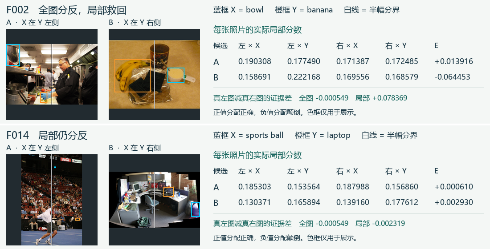

# 固定左右半图，能否帮助 HPS 判断物体的左右关系？

**1. 同预算下，局部名词方案净多分对 32 对。** 每张照片均用两个视觉输入、四条图文评分。局部方案分对 52/64，全图加镜像分对 20/64，严格正确率差 **+50.0 个百分点**（整图对配对 bootstrap 95% 区间 [+32.81, +65.62]）。

**2. 收益在两张图都清楚分居时最大，也出现在其余两层。** 两张、仅一张、零张满足分居标准的图对分别净增 **17、12、3 对**。标准在评分前冻结，要求每个物体至少 75% 的可见框面积落在相反半边。

**3. 在 78 张清楚分居的照片中，两个名词都定位正确 44 张**，仅一个正确 30 张、两个都错 2 张、含同分 2 张（任一同分优先单列）。X 在正确半边得分更高 58/78，Y 为 62/78。仅定位对一个名词时，合并证据仍有 25/30 张指向正确方向。

| 方向证据 | 每图视觉输入／图文评分 | 正确 | 颠倒 | 同分 |
|---|---:|---:|---:|---:|
| 原图左右两句分差 | 1 / 2 | 30 | 34 | 0 |
| 全图＋镜像的方向分差 | 2 / 4 | 20 | 36 | 8 |
| 左右半图的名词分差 | 2 / 4 | 52 | 12 | 0 |

相对四评分全图对照，局部方案把 **30 对颠倒和 8 对同分变为正确**，也把 **6 对原先正确的图对分反**。相对原图两评分，保住 23/30 对，救回 29/34 对。[逐对转移与 ID](transitions.csv)

128 张照片中，清楚分居 78 张，其余 50 张。下表以自然图对为单位。

| 每对清楚分居的照片数 | 图对数 | 原图正确 | 全图＋镜像正确 | 局部正确 | 正确率净差 |
|---|---:|---:|---:|---:|---:|
| 2 | 25 | 7/25 | 8/25 | 25/25 | +68.0 个百分点 |
| 1 | 28 | 18/28 | 9/28 | 21/28 | +42.9 个百分点 |
| 0 | 11 | 5/11 | 3/11 | 6/11 | +27.3 个百分点 |

每对把证据较大的照片分给左题。令 d 为同一视图左提示分减右提示分，全图对照用 [d(原图)−d(镜像)]/2。局部证据 E 为 X 的左半图分减右半图分，加上 Y 的右半图分减左半图分。两者共用同一分配规则。图像裁法和文本也同时改变，这批结果支持组合方案，尚不能分离两个改动各自的贡献。

全图分反、局部救回共 30 对，局部分反共 12 对。图例按类别内可公开展示裁图的最小 ID 选取。[照片来源](credits.md) · [四项原始评分](scores.csv) · [逐图定位](image_results.csv) · [逐对分配](pair_results.csv)

Asus RTX 4090 · HPS v2.1，CUDA FP16。新增 512 条评分、256 次视觉前向；续跑命中 16 条冒烟评分，另读取旧缓存 512 条。两段评分墙钟合计 42.7 秒，图像前向及相似度合计 4.8 秒。[复现与坐标映射](README.md) · [两对冒烟输入](smoke/overview.jpg)
