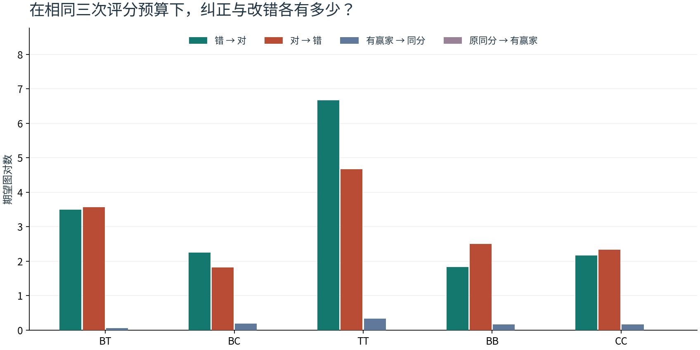
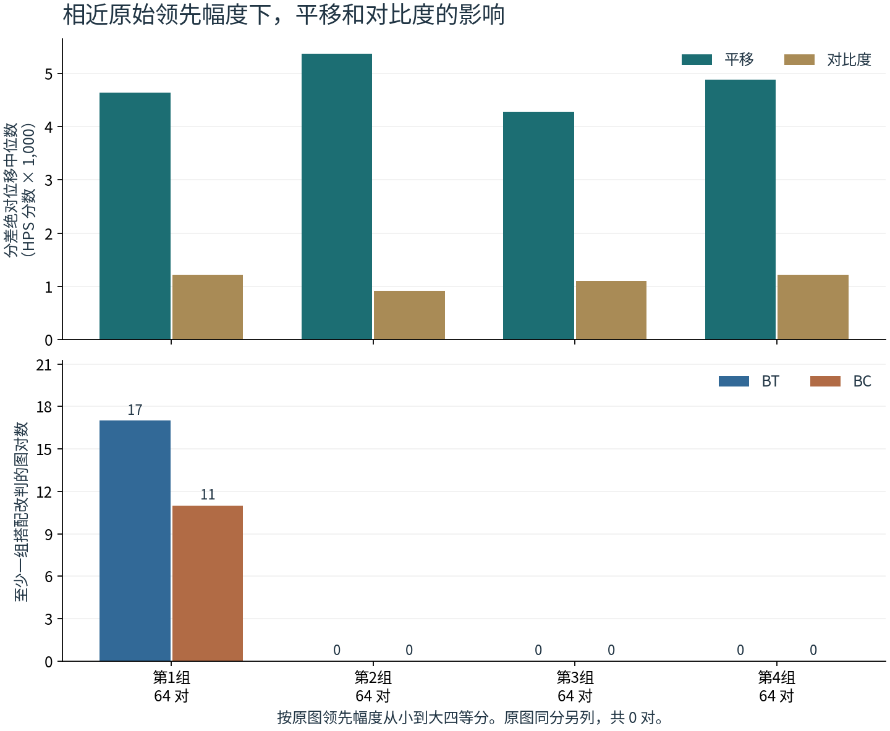

# 轻微平移为什么会纠正一些排序，也会破坏另一些？

① 在 256 个独立提示词上，BT 至少一次纠正了 7 对 BC 从未纠正的原始错例，其中 7 对连 BB、CC 也未能纠正，7 对单用平移策略 TT 就能纠正。

② 均匀抽取搭配时，BT 比 BC 多纠正 1.25 对原始错例，原本选对者的严格改错数之差为 1.75 对；计入同分去向后，净变化为 -0.3750 个期望正确图对，即 -0.146 个百分点（配对 95% 区间 ［-1.465，+1.270］）。

③ 原始小分差和可重复的方向效应同时可见：BT 或 BC 的 21 个改判案例中，21 个落在原始领先幅度最小的四分组；BT 改判的 17 对中，9 对由多个方向触发，16 对在同一方向跨亮度档重复。

## 独立复验 · 三次评分能选对多少

排除旧提示词与图像后，validation 有 344 条合格规范化文本。以种子 2026 冻结其中 256 条，每条只保留一对严格人工排名。原图选对 175 对、选错 81 对、同分 0 对。B、C 分别为亮度与对比度，T 为平移。每种具体搭配先把原图和两个增强版本等权平均，严格按分差符号选图。人类赢家始终取自原文和原图。

| 策略 | 选对 / 总搭配判定 | 期望选对数 | 严格选对率 | 期望选错数 | 期望同分数 | 至少一次改判的图对 |
|---|---|---|---|---|---|---|
| O | 175 / 256 | 175 | 68.359% | 81 | 0 | 0 |
| BT | 2799 / 4096 | 174.9375 | 68.335% | 81 | 0.0625 | 17 |
| BC | 2805 / 4096 | 175.3125 | 68.481% | 80.5 | 0.1875 | 11 |
| TT | 1060 / 1536 | 176.6667 | 69.010% | 79 | 0.3333 | 22 |
| BB | 1045 / 1536 | 174.1667 | 68.034% | 81.6667 | 0.1667 | 9 |
| CC | 1048 / 1536 | 174.6667 | 68.229% | 81.1667 | 0.1667 | 11 |

BT 与 BC 各有 4,096 次搭配判定，独立抽样单位有 256 个。每对先取选对比例之差，再按整对重采样 10,000 次，固定种子 2026。主终点区间换算成期望对数为 ［-3.750，+3.250］。区间跨过零，本次复验无法确定哪种策略的总体严格选对率更高。

### 按原图判定对账

每格依次列最终「选对 / 选错 / 同分」的期望对数。每格的三项加起来等于该行的图对数，小数来自在预设搭配中均匀取样。

| 原图状态 | 图对数 | BT | BC | TT | BB | CC |
|---|---|---|---|---|---|---|
| 错 | 81 | 3.5 / 77.4375 / 0.0625 | 2.25 / 78.6875 / 0.0625 | 6.6667 / 74.3333 / 0 | 1.8333 / 79.1667 / 0 | 2.1667 / 78.8333 / 0 |
| 对 | 175 | 171.4375 / 3.5625 / 0 | 173.0625 / 1.8125 / 0.125 | 170 / 4.6667 / 0.3333 | 172.3333 / 2.5 / 0.1667 | 172.5 / 2.3333 / 0.1667 |
| 同分 | 0 | 0 / 0 / 0 | 0 / 0 / 0 | 0 / 0 / 0 | 0 / 0 / 0 | 0 / 0 / 0 |

对严格选对数的贡献，来自原始错例 +1.2500 对、原始对例 -1.6250 对、原始同分 +0.0000 对，合计 -0.3750 对。原始对例转成同分的 BT−BC 差为 -0.1250 对。原始错例新增纠正的配对区间为 ［-1.438，+4.438］ 对；原始正确样本新增严格改错的区间为 ［+0.000，+3.938］ 对。

### 哪些样本带来收益和损失

下表逐对列出 BT 补到、BC 从未纠正的原始错例，以及各策略严格选对的搭配数。这些病例支持平移提供了额外纠正；单用平移已能达到这一结果，因而缺少把收益归为亮度与平移协同的证据。

| 图对 | 原始 A−B | 人工赢家 | BT /16 | BC /16 | TT /6 | BB /6 | CC /6 |
|---|---|---|---|---|---|---|---|
| N030 | 0.0010986 | B | 3 | 0 | 2 | 0 | 0 |
| N032 | -0.0041504 | A | 4 | 0 | 4 | 0 | 0 |
| N088 | -0.0050049 | A | 2 | 0 | 2 | 0 | 0 |
| N147 | -0.0053711 | A | 1 | 0 | 1 | 0 | 0 |
| N171 | 0.0046387 | B | 3 | 0 | 6 | 0 | 0 |
| N207 | -0.0024414 | A | 14 | 0 | 6 | 0 | 0 |
| N217 | -0.0024414 | A | 12 | 0 | 4 | 0 | 0 |

原图正确、BC 至少一次保持正确而 BT 至少一次严格改错的有 7 对；其中 6 对仅部分搭配改错，1 对全部 16 种改错。BC 全部保持正确的严格子集为 N107、N135、N223。

| 图对 | 原始 A−B | 人工赢家 | BC 选对 /16 | BT 改错 /16 | BT 同分 /16 | BT−BC 期望选对数 |
|---|---|---|---|---|---|---|
| N083 | 0.0009766 | A | 11 | 14 | 0 | -0.5625 |
| N097 | -0.0021973 | B | 5 | 12 | 0 | -0.0625 |
| N107 | 0.0039062 | A | 16 | 2 | 0 | -0.125 |
| N135 | 0.0048828 | A | 16 | 2 | 0 | -0.125 |
| N141 | -0.0030518 | B | 9 | 16 | 0 | -0.5625 |
| N223 | 0.0023193 | A | 16 | 7 | 0 | -0.4375 |
| N241 | -0.0002441 | B | 8 | 4 | 0 | 0.25 |

BT−BC 逐对贡献中，9 对为正，合计 +3.1250 个期望正确图对；12 对为负，合计 -3.5000，余下 235 对贡献为零。

最大正贡献为 N207，各 +0.8750 对（对主终点各贡献 +0.342 个百分点，占正向总量的 28.0%）。单独去掉其中一对，余下 255 对的 BT−BC 为 -0.490 个百分点。

最大负贡献为 N083、N141，各 -0.5625 对（对主终点各贡献 -0.220 个百分点，占负向总量的 16.1%）。单独去掉其中一对，余下 255 对的 BT−BC 为 +0.074 个百分点。

## 原始领先幅度与平移位移

位移为单个增强版本的 A−B 分差减原图分差。表中位移取绝对值，再对每组的图对与四个版本取中位数。「改判」包括进入或离开同分，「翻转」只计严格异号。

| 原始领先幅度组 | 图对数 | 领先幅度范围 | 领先中位数 | 亮度位移 | 对比度位移 | 平移位移 | 平移大 / 等 / 小¹ | BT / BC 改判对数 | BT / BC 翻转对数 | BT−BC 百分点 |
|---|---|---|---|---|---|---|---|---|---|---|
| 第1组 | 64 | 0.0002441 至 0.0083008 | 0.0046387 | 0.0012207 | 0.0012207 | 0.0046387 | 60 / 0 / 4 | 17 / 11 | 17 / 11 | -0.5859 |
| 第2组 | 64 | 0.0084229 至 0.0175781 | 0.0136719 | 0.0012207 | 0.0009155 | 0.0053711 | 63 / 0 / 1 | 0 / 0 | 0 / 0 | 0 |
| 第3组 | 64 | 0.0178223 至 0.0317383 | 0.0246582 | 0.0012207 | 0.0010986 | 0.0042725 | 60 / 1 / 3 | 0 / 0 | 0 / 0 | 0 |
| 第4组 | 64 | 0.0319824 至 0.1853027 | 0.0482178 | 0.0013428 | 0.0012207 | 0.0048828 | 61 / 0 / 3 | 0 / 0 | 0 / 0 | 0 |
| 原同分 | 0 | — | — | — | — | — | 0 / 0 / 0 | 0 / 0 | 0 / 0 | — |

¹ 先在同一对图内分别取平移与对比度四个版本的绝对位移中位数，再比较两者。

四个非平局组中，有 4 组的典型平移位移大于对比度位移。在原本就有赢家的图对中，21/21 个 BT 或 BC 改判案例集中在最低四分组。较大的分数位移描述模型的敏感性；准确性还取决于移动方向与人工赢家。

## 同一图对能否跨参数重现

以下每个方向的分母都是四个亮度档。8 对只在一个方向触发，9 对在多个方向触发；1 对只在 16 格中的一格触发，9 对至少有一个方向在四档亮度下都触发。仅用原图和单方向平移等权平均，17/17 对也会在至少一个方向改判。

| 图对 | 原图 | 左 /4 | 右 /4 | 上 /4 | 下 /4 | 涉及亮度档数 | 原图＋单平移会改判的方向 |
|---|---|---|---|---|---|---|---|
| N020 | 错 | 4 | 0 | 4 | 4 | 4 | 左、上、下 |
| N030 | 错 | 2 | 0 | 0 | 1 | 2 | 左、下 |
| N032 | 错 | 0 | 0 | 4 | 0 | 4 | 上 |
| N083 | 对 | 4 | 4 | 2 | 4 | 4 | 左、右、上、下 |
| N088 | 错 | 0 | 0 | 0 | 2 | 2 | 下 |
| N097 | 对 | 2 | 2 | 4 | 4 | 4 | 左、上、下 |
| N107 | 对 | 2 | 0 | 0 | 0 | 2 | 左 |
| N135 | 对 | 0 | 2 | 0 | 0 | 2 | 右 |
| N141 | 对 | 4 | 4 | 4 | 4 | 4 | 左、右、上、下 |
| N147 | 错 | 0 | 1 | 0 | 0 | 1 | 右 |
| N156 | 错 | 0 | 0 | 2 | 1 | 2 | 上 |
| N164 | 错 | 3 | 0 | 0 | 0 | 3 | 左 |
| N171 | 错 | 0 | 0 | 0 | 3 | 3 | 左、右、上、下 |
| N207 | 错 | 4 | 4 | 3 | 3 | 4 | 左、右、上、下 |
| N217 | 错 | 4 | 4 | 4 | 0 | 4 | 左、右、上 |
| N223 | 对 | 4 | 1 | 2 | 0 | 4 | 左、右、上 |
| N241 | 对 | 0 | 0 | 0 | 4 | 4 | 下 |

对每个搭配，三次评分后的分差等于原始分差加上两个增强位移之和的三分之一。原图有赢家时，位移之和须与原分差反向且幅度超过其三倍，才会严格换赢家。等于阈值时打平。以下各取最大正、负贡献样本中第一个实际改变选择的 BT 搭配。

- N207（人工赢家 A）在 B090、Tleft 下，原分差 -0.0024414，亮度位移 -0.0012207，平移位移 +0.0111084，三分均值分差 +0.0008545。原图选 B，组合选 A。

- N083（人工赢家 A）在 B090、Tleft 下，原分差 +0.0009766，亮度位移 +0.0025635，平移位移 -0.0155029，三分均值分差 -0.0033366。原图选 A，组合选 B。

每个方向的严格翻转、最终选对、选错与同分计数见 [方向明细](direction_counts.csv)。同一图对的方向和亮度档共享两张候选图。数据足以描述这些案例，尚不足以判断哪类构图普遍受益。

## 旧 64 对 · 案例复核

从 P2 的 2,176 条原始分数独立枚举十项策略，每对 120 种搭配。仅 003、008、053、005、031 至少一次改变原始选择。003 原图选错，TT 纠正 4/6、BT 纠正 4/16；008 原图选对，BT 改错 16/16。下表显示原图与单一平移等权平均的选择，便于对照方向。

| 旧图对 | 人工赢家 | 原始 A−B | 原图选择 | 原图＋左 | 原图＋右 | 原图＋上 | 原图＋下 |
|---|---|---|---|---|---|---|---|
| 003 | B | 0.0053711 | A | A | A | B | B |
| 008 | A | 0.0008545 | A | B | B | B | B |
| 053 | B | 0.0021973 | A | A | A | A | A |
| 005 | A | 0.0004883 | A | tie | tie | A | B |
| 031 | B | -0.0012207 | B | A | A | B | B |

[打开五个旧案例](old_cases/index.html)。每例含原文、原始图像、模型看到的 224 × 224 输入、BT 的 4 × 4 分差与判定，以及四种单方向结果。可直接比较边缘纹理和位置的改变；当前实验没有测量模型关注的图像区域。旧案例未并入独立样本估计。

## 运行与验收

在 NVIDIA GeForce RTX 4080 SUPER 单卡上运行 HPS v2.1，官方验证变换和 CUDA fp16 autocast，原生分数为 float16，保存可精确往返的十进制，再用 float64 汇总。2 对冒烟新增 52 条并与官方评分入口逐项相等；全量阶段从检查点命中 52 条，独立样本从旧评分命中 0 条。新增唯一评分 6,656 条；冒烟验证另做 52 次图像前向。

冒烟墙钟 30.0 秒，全量续跑 275.4 秒，合计 305.4 秒。生产评分 CUDA event 累计 201.2 秒，含文本与图像编码及点积；额外官方数值核对计入墙钟。

独立核验 256 个提示词、512 张图、每图 13 种视图、6,656 条唯一评分。12,800 个三次组合均通过分差恒等式与整数精确判定；配对区间可独立复算。样本清单哈希为 `7b06fc4d4c766fe70b41bfe434f90ab92d25b16e2b734a3f5af9e2d6da0095fe`。结论限于本次 validation 独立提示词、HPS v2.1、3% 平移及预设的参数池。

抽样与指标见 [冻结协议](protocol.md)，完整操作见 [README](README.md)。[原始评分](scores.csv) · [逐对策略](pair_strategy_results.csv) · [逐对贡献](pair_contributions.csv) · [全部搭配](combination_results.csv) · [验收记录](verification.json)。
