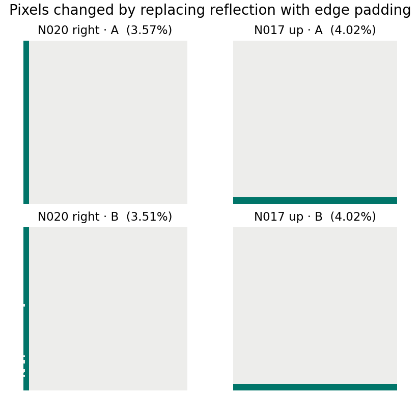

# 相同的平移，换一种补边会改变选择吗？

把反射填边换成复制最外像素，平移后来自原图的重叠区逐像素相同。1,024 个图对与方向组合中，999 个单视图有向分差发生变化，变化绝对值中位数 **0.001892**，四分位区间 [0.000732, 0.003540]。均匀选方向时，复制填边比反射填边少选对 **0.75 个期望图对**，严格选对率差 **−0.293 个百分点**，配对 95% 区间 [−1.074, +0.393]。

| 每图使用原图和一个视图 | 期望选对 / 错 / 同分 | 相对原图错→对 | 对→错 | 对→同 / 错→同 |
|---|---:|---:|---:|---:|
| 反射填边 | 176.25 / 79.25 / 0.50 | 6.50 | 5.00 | 0.25 / 0.25 |
| 复制填边 | 175.50 / 80.00 / 0.50 | 5.75 | 5.00 | 0.25 / 0.25 |

原图严格选对 175/256。直接把反射换成复制，平均 2 对错→对、2.75 对对→错，另有 0.25 对错→同、0.25 对同→错。各方向先独立选图，再等权平均；置信区间按整对重采样。

**哪几次纠正依赖填边？** 在原始错例中，若四方向任一方向能救回，两种实现都能救回 11 对，仅反射能救回 N017、N088、N147，仅复制能救回 0 对。把方向也固定，11 对中有 10 对至少在同一方向都能救回；N092 需要不同方向。原始正确图对中，两种实现都有方向改错 8 对，仅反射改错 N023、N056、N185，仅复制改错 N087、N179。两种实现都出现过新平局的为 N097、N231。所有 ID 与逐方向判定见 [覆盖清单](summary.json) 和 [分差表](pair_directions.csv)。这些结果只检验两种补边，共有的画面移出仍然存在。

**实际改了哪些像素？** 以单张图、单方向为单位，源图变化像素占比的中位数为 2.93%，源图新边带的 RGB 平均绝对差中位数为 0.04955（RGB 范围 0–1）。在 HPS 输入上有 3.57% 的位置发生变化，改变位置上的 RGB 平均绝对差中位数为 0.03415，整幅为 0.001074。双三次缩放会影响边带附近像素。

N020 右移时，反射改复制使聚合分差从 −0.000366 变成 +0.000488，选回人工赢家。N017 上移时则从 +0.000854 变成 −0.001587，丢掉了一次纠正。六个接近 FP16 输出间距的改判搭配按原精度独立重复，36/36 条原始评分完全一致。该检查支持同精度复现，FP32 下的边界选择仍未测量。[精度复核](repeated.csv)
