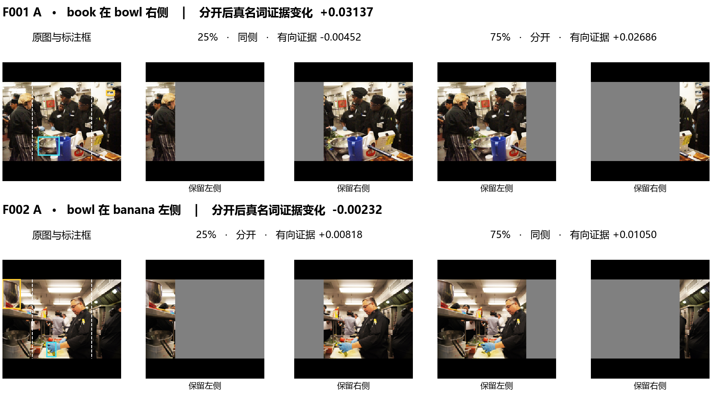

# 同一张照片里，把两个物体分给不同视图有帮助吗？

**在预先选定的 64 张照片上，把分界线从“两物体同侧”移到“两物体分开”，真名词的正确方向证据平均增加 0.03224；48 张增强，16 张减弱。**

替代词的平均变化为 −0.00408，因此唯一主指标「真词增量减替代词增量」为 **+0.03632**，按 48 个原始图对整簇 bootstrap 的 95% 区间为 **[+0.02224, +0.05068]**。

**两个移动方向均成立。** 移到 25% 线才分开时，真词比替代词多增 +0.04125；移到 75% 线才分开时，多增 +0.03248。

| 从同侧移到分开 | 照片 / 原始图对 | 真词增量 | 替代词增量 | 两增量之差 [95% 区间] | 真词错→对 / 对→错 | 替代词错→对 / 对→错 |
|---|---:|---:|---:|---:|---:|---:|
| 全部合格照片 | 64 / 48 | +0.03224 | −0.00408 | **+0.03632 [+0.02224, +0.05068]** | 42 / 12 | 15 / 31 |
| 从 75% 移到 25% | 28 / 25 | +0.04120 | −0.00006 | +0.04125 [+0.01952, +0.06544] | 18 / 4 | 10 / 12 |
| 从 25% 移到 75% | 36 / 32 | +0.02528 | −0.00720 | +0.03248 [+0.01895, +0.04617] | 24 / 8 | 5 / 19 |

证据单位为 HPS 分数的有向差，正值表示与该照片的 COCO 框方向一致。用真名词时，单照片严格判断正确由 **21/64 增至 51/64**，无同分。用替代词时由 41/64 降到 25/64，另有 1 张错→同分，出现在 75% 分开组。真词增量的 95% 区间为 [+0.01963, +0.04522]，替代词为 [−0.00866, +0.00062]。结论限于相同画布、灰色遮挡和冻结词表；移动分界线也会改变可见背景。替代类别在两候选中均未标注。

### 50% 中线在全部 64 对上表现怎样？

这里每对须比较两张自然照片，选出哪张更符合“X 在 Y 左”。每种呈现、每组词、每张照片均使用两个视图和四个相似度。

| 中线视图 | 真名词正确 / 颠倒 / 同分 | 替代词正确 / 颠倒 / 同分 | 真词净多分对 |
|---|---:|---:|---:|
| 原尺寸遮挡半边 | 51 / 13 / 0 | 33 / 30 / 1 | 18 对 |
| 旧实验裁出半幅再缩放 | 52 / 12 / 0 | 29 / 35 / 0 | 23 对 |

同画布遮挡下，真词优势仍为 +28.13 个百分点 [12.50, 43.75]。相对旧裁剪，优势缩小 7.81 个百分点，配对区间 [−20.31, +3.13] 跨零；现有数据不足以确定呈现方式改变了优势大小。

F001 A 的 book / bowl 分开后从判反变为判对；F002 A 的 bowl / banana 在两条线下都判对，但分开后证据减弱了 0.00232。图中原图面板加框和分线，四个遮挡面板取自实际模型输入。全批 128 张照片均已完成三条线评分，共 768 次视觉前向、3,072 条相似度。[逐照片结果](primary_photos.csv) · [复现与照片署名](README.md)
