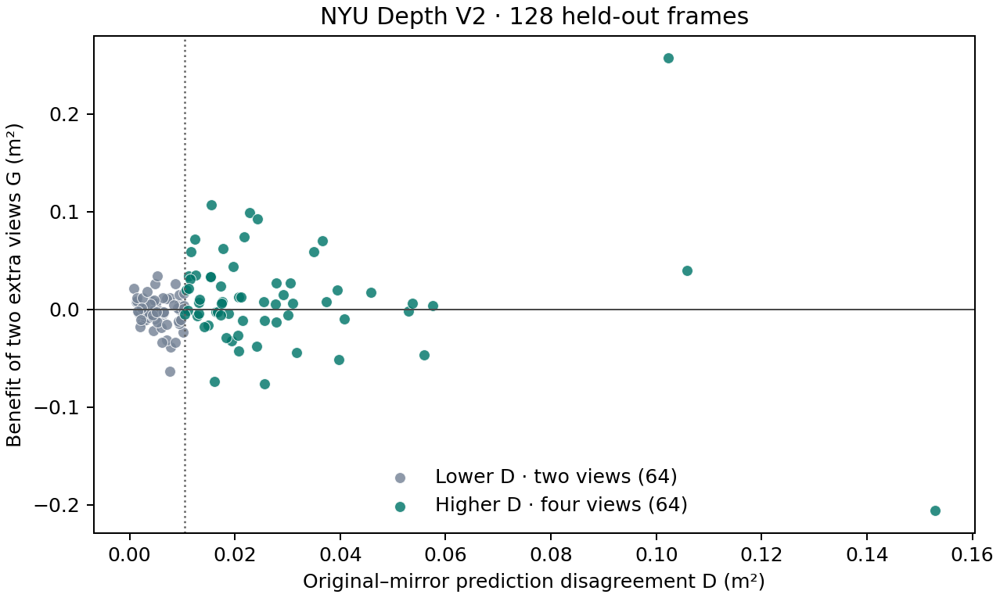

# 深度预测分歧能指导下一次推理吗？

**这批 NYU 图像中，分歧大的一半追加两次推理后，帧均 MSE 降低 0.010583 m²；分歧小的一半反而升高 0.002632 m²。**
**同样用 384 次推理，按分歧追加比随机追加少 0.003304 m²，比每帧均匀算三次少 0.002351 m²。** 两个场景簇 bootstrap 的 95% 区间都跨零，分别为 [−0.000609, +0.006492] 和 [−0.000908, +0.004679] m²。
**离事后最佳分配还差 0.008410 m²**（95% 区间 [0.005208, 0.013774]）。两种分配各选 64 帧，只有 37 帧重合。

| 整批策略 | 128 帧部署前向数 | 帧均 MSE（m²，越低越好） |
|---|---:|---:|
| 全部只算原图 O 和镜像 F | 256 | 0.626609 |
| A，每帧在 O、F 上随机追加左移或右移 | 384 | 0.623669 |
| B，随机选半数帧，各追加左移和右移 | 384 | 0.624622 |
| C，按原图与镜像的预测分歧选前半数追加 | 384 | **0.621318** |
| 全部做四视图 | 512 | 0.622634 |
| **事后上限**，利用真值挑追加收益最大的 64 帧 | 384 | 0.612908 |

| 按分歧分组 | 帧数 | 平均分歧 D（m²） | 平均追加收益 G（m²） | 误差降低 / 增加 / 相等 |
|---|---:|---:|---:|---:|
| 高 | 64 | 0.028259 | +0.010583 | 37 / 27 / 0 |
| 低 | 64 | 0.005448 | −0.002632 | 29 / 35 / 0 |

每点一帧，零线上方表示追加平移后误差下降。分歧很大的帧也能向两个方向变化。图中 nyu_0334 的误差下降 0.256857 m²，而最高分歧帧 nyu_0118 的误差上升 0.205879 m²。分歧适合作为批内调度信号继续检验，单帧收益仍有很大差别。

**评价口径。** NYU Eigen 测试划分排除旧 P3 的 64 帧后，从余下 590 帧冻结抽取 128 帧，覆盖 95 个场景。先逆对齐，再在四视图共同可见区域计算原图和镜像深度差的均方 D；写入批内前 64 帧名单后才读取深度真值。评价沿用米制有效范围 (0,10]，每帧等权。G 为两视图 MSE 减四视图 MSE。A 精确平均两种三视图选择各自的误差；B 对每帧精确平均两视图和四视图误差。区间按场景整簇重采样 10,000 次，每次重排预算。

**实测成本。** Asus 物理 3 号 RTX 4090 完成 512 次新前向，缓存命中 0。测量流程墙钟 19.65 秒，含加载、推理、落盘与评价。前两帧的 4 次 O/F 前向纳入总预算；其余 508 次每视图平均前向 11.60 ms、视图变换 2.02 ms、官方预处理及传入 GPU 11.89 ms、恢复尺寸并传回 CPU 0.38 ms、逆对齐 0.17 ms。[逐帧数据](frame_results.csv) · [复现及误差核验](README.md)
