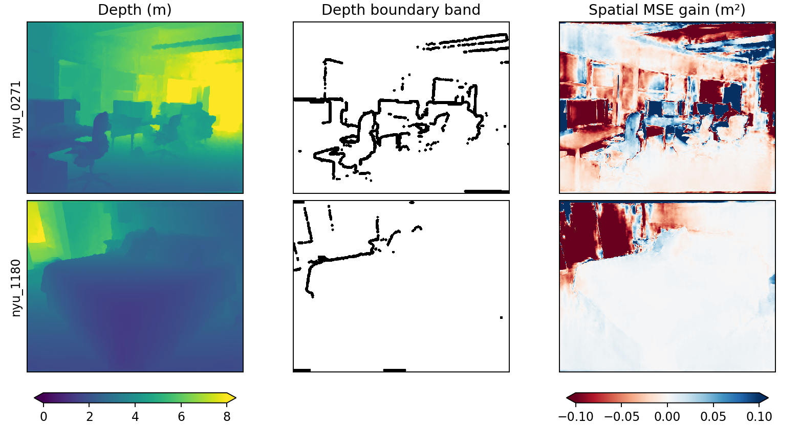

# 追加平移视图修正了全帧距离，还是改变了空间结构？

固定 128 帧、模型和评价像素，把四视图相对两视图的变化拆为「每帧加一个常量」和「余下的空间变化」。**追加左右平移平均降低 MSE 0.003975 m²，其中整体距离平移贡献 +0.002799 m²，空间项贡献 +0.001176 m²。** 两项的场景簇区间都跨零。边界带每像素的空间收益较大，但按实际面积计算，开发样本中内部区域贡献更多。

| 帧均误差降幅（正值有益） | 均值（m²） | 95% 场景簇区间（m²） | 受益 / 变差 / 持平帧 |
|---|---:|---:|---:|
| 两视图 → 只调整全帧均值 | +0.002799 | [−0.002141, +0.007721] | 73 / 55 / 0 |
| 只调整全帧均值 → 四视图（主比较） | +0.001176 | [−0.002058, +0.005332] | 72 / 56 / 0 |
| 两视图 → 四视图（旧追加收益） | +0.003975 | [−0.002770, +0.010891] | 66 / 62 / 0 |

在 53/128 帧中，两项贡献符号相反。每帧的均值项与空间项之和逐项复现旧追加收益，最大残差为零。全帧平移量来自四视图预测，属于事后解释；部署时必须已经拿到四视图输出。

| 区域（各帧等权） | 平均面积 | 两视图基线 MSE | 移均值后 MSE | 区域内空间收益 | 对全帧空间收益的贡献 [95% 区间] |
|---|---:|---:|---:|---:|---:|
| 深度跳变边界带 | 5.83% | 0.862455 | 0.858934 | +0.002507 | +0.000237 [−0.000334, +0.000847] |
| 内部 | 93.43% | 0.607038 | 0.604318 | +0.001142 | +0.001005 [−0.001840, +0.004660] |
| 四邻域不完整 | 0.75% | 0.735793 | 0.734108 | −0.008731 | −0.000065 [−0.000163, +0.000029] |

误差及收益单位均为 m²。最后一列先在每帧计算「面积比例 × 区域收益」，再取帧均值，各行相加复现空间项。边界带原本的误差也较高。这批数据支持区分全帧加性偏差与空间变化，空间项还可能包含距离比例误差；不能由此把空间收益全归给轮廓。

按冻结顺序各取首个空间收益正、负的帧。nyu_0271 的均值项为 +0.014370、空间项为 +0.002631 m²；nyu_1180 分别为 −0.019661、−0.012773 m²。右列蓝色为改善，红色为变差，两个案例共用 ±0.1 m² 色标。[逐帧完整数值](frame_results.csv)
