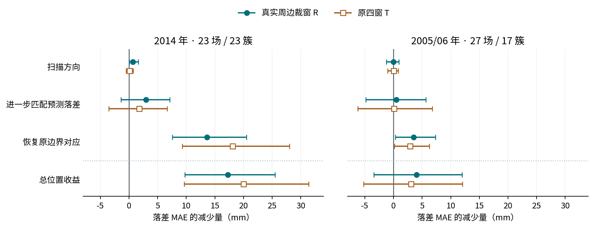

# 方向和预测落差相近，能替代原边界对应吗？

**2014 年的 17.28 mm 总位置收益中，按扫描方向和预测落差分档只保留了 3.67 mm；把修正放回原边界，仍额外降低落差 MAE 13.61 mm［7.56, 20.50］。** 真实周边裁窗 R 在 23 场中有 22 场出现这一剩余收益。

**2005/06 年也出现同方向结果，幅度较小。** 档内随机互换与真实对应的 MAE 分别为 253.65 和 250.14 mm，配对差 **+3.50 mm［0.33, 7.34］**。27 场中 16 场为正、11 场为负。这批的总位置收益为 +4.03 mm［−3.45, 11.98］；它比较的是全场随机与真实对应，和主指标使用不同的参照。

| 批次与方法 | 匹配扫描方向 | 再匹配预测落差 | 再恢复原边界对应（主指标取 R） | 总位置收益 |
|---|---:|---:|---:|---:|
| 2014 · 真实周边 R | +0.68［0.04, 1.62］ | +2.99［−1.37, 7.11］ | **+13.61［7.56, 20.50］** | +17.28［9.75, 25.48］ |
| 2014 · 原四窗 T | +0.14［−0.50, 0.72］ | +1.78［−3.54, 6.68］ | +18.11［9.28, 28.03］ | +20.03［9.65, 31.37］ |
| 2005/06 · 真实周边 R | +0.0003［−1.23, 0.94］ | +0.52［−4.82, 5.68］ | **+3.50［0.33, 7.34］** | +4.03［−3.45, 11.98］ |
| 2005/06 · 原四窗 T | +0.04［−1.00, 0.85］ | +0.13［−6.22, 6.79］ | +2.93［0.14, 6.28］ | +3.10［−5.20, 12.02］ |

单位为 mm，正值表示该步降低了误差。前三项在取整前逐场相加等于总收益。点为簇等权均值，横线为按场景簇配对重采样 10,000 次的 95% 区间。

**单纯缩小可交换范围的影响很小。** 固定方向和每档的人数，随机打乱档位 100 次，R 相对只匹配方向的平均收益在两批分别为 **0.022、0.035 mm**；用真实预测落差分档则是 **2.986、0.524 mm**。在各自固定的这批场景上，100 次随机分档均未达到真实分档的平均收益。跨场景簇估计，真实分档比同人数随机分档分别多改善 2.96 mm［−1.39, 7.09］和 0.49 mm［−4.83, 5.61］，这一项本身仍不确定。

**两批均为回顾性分析。** 2014 全部 188,235 条边来自 23 场／23 簇，2005/06 全部 55,583 条边来自 27 场／17 簇。两批分别形成 230、265 个非空档，单元素档均为 0，覆盖比例均为 0%。分档量只取 B 预测的三点中位深度差绝对值；GT 沿用旧评价位置并用于计分。结果支持**这两个分组变量未能解释全部位置收益**；剩余收益的图像机制尚未识别。Asus 全量 CPU 计算，新增模型前向 0。[逐场结果](results/per_scene.csv) · [分档覆盖](results/coverage.csv) · [大小对照](results/size_control_summary.csv) · [复现命令](README.md)
