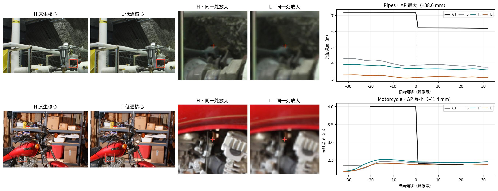
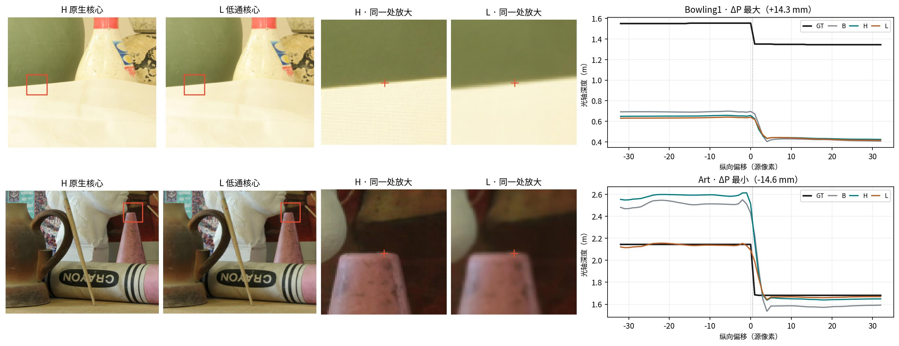

# 裁窗细节与遮挡边界的深度落差

[一页中文报告](report.md) · [冻结协议](protocol.md) · [逐场数据](results/per_scene.csv) · [配对差与区间图](figures/paired_intervals.png)

## 数据与核验

冻结起点为 `e8ad37d19851c3467cacdff9add8717253148e5c`。[冻结记录](freeze.json) 固定了协议、来源哈希和 [50 场输入清单](../depth_occlusion_context/scenes.csv)。2014 年 23 场各成一簇，2005/06 年 27 场沿用 17 个布景簇。共同使用 243,818 条界面、495 个档和相同的采样像素。先按场内各档实际边数加权，再对簇内场景等权、对簇等权。场景级正负计数不等同于按簇加权的平均效果。

B 为一次默认全图预测。H 与 L 各用 B 和四个真实周边窗。H 读取前次原生窗预测；L 只替换核心的 RGB，窗内距边缘 0 至 8 个编码器像素的低通权重从 0 线性增至 1。源图按旧 CPU float32 area 流程降至 B 的实际栅格，再用 bilinear 和 `align_corners=False` 恢复原尺寸，RGB 半向上取整。然后走与原生核心相同的裁取、重采样及归一化流程。所有画布保持原几何，核心外数据逐元素核验。每个编码器输入有 3 个通道，核心高 518、宽 574–812，画布高 686、宽 770–1,078。精确坐标、实际高宽、张量哈希、改变像素、RGB 绝对差与 H/L 尺度系数逐窗保存。[逐窗输入](results/input_windows.csv) · [输入汇总](results/input_summary.csv)

主口径 `native_R` 对两个条件共用旧 R 的尺度，`low_core` 对两个条件共用从 L 估出的尺度。从每张完整融合图重新取同一界面两侧的三点中位数。分箱沿用旧切点，重配含自配，MAE 用排序和前缀和精确求期望。平方损失用米计算，对档内所有有序组合分块枚举，并与总体协方差（分母 n）和二阶矩计算分别核验。对 H 与 L，重配与真实平方损失共有的两项为均方 r 和均方 u，两式相减后得到 2(E[ru]−E[r]E[u])。对两条件作差时，u_H−u_L 等于两个实际预测落差之差。两套尺度下总共逐项检查 1,013,585,592 个有序组合。另从原始深度窗独立取样、重算融合与 800 个场级量，并按簇重新核对配对区间。[逐档平方损失与协方差](results/per_bin_mse.csv) · [恒等式核验](results/checks.json) · [独立复算](results/verification.json)

## 在 Asus 复现

原始运行使用四张空闲 RTX 4090（物理 1–4，按 UUID 绑定）。冻结的 Depth Anything V2 Metric Indoor Small 修订为 `8078d68a9c75a972131914f6afd0c1723be0da7f`，PyTorch 2.5.1+cu124、Transformers 4.46.0、Pillow 12.2.0、NumPy 1.26.4，FP32 推理、关闭 TF32。正式任务复用 50 张 B、200 个 H 窗，首次新增 200 个 L 窗、50 个四窗批次，续跑命中 0。四个 GPU 进程在模型就绪后的实测时长分别为 23.11、24.37、15.02、18.11 秒。逐场前向与回映时间、准备时间、峰值显存和预测哈希见缓存索引。[设备快照](results/start_devices.csv) · [软件与权重哈希](results/worker_0.json) · [缓存索引与耗时](results/cache_index.csv)

下面使用 Asus 上已有的数据、权重和 Python 环境。将本目录放在仓库相同位置。历史预测、输入与边界只读，新低通像素预测位于 `$DETAIL_DATA/<年份>/<场景>/low.npy`，同目录 `score.json` 保存实现签名与张量哈希。如需保留首次运行的时间与缓存命中记录，可在另一份仓库副本执行。

```bash
set -e
cd /home/shenc/tta_depth_adaptive/P3/depth_jump_detail_intervention
export OCC_DATA=/home/data/users/shenc/tta_occlusion_data
export CTX_DATA=/home/data/users/shenc/tta_occlusion_context
export EDGE_CACHE=/home/data/users/shenc/tta_edge_conditional_assignment_v1
export DETAIL_DATA=/home/data/users/shenc/tta_jump_detail_intervention_v1
export OCC_MODEL=/home/shenc/tta_depth_adaptive/data/model
export PYTHONPATH=/home/data/users/shenc/zhangyc/tta_pilot/.venv/lib/python3.10/site-packages
export PYTHONDONTWRITEBYTECODE=1 OMP_NUM_THREADS=2 MKL_NUM_THREADS=1 OPENBLAS_NUM_THREADS=1
PY=/home/shenc/tta_geometry_specificity_asus/runtime/bin/python
sha256sum -c source_sha256.txt
mkdir -p results
CUDA_VISIBLE_DEVICES="" "$PY" replay.py
```

Asus 上已有全部 L 预测和发表时的进程记录，可直接跳至 CPU 分析。以下为首次生成或断点续跑命令。指定新的空 `DETAIL_DATA` 可以独立重建全部 200 个窗。每个进程按照场景清单分片，每场只对四个新输入推理一次。

```bash
mapfile -t cards < <(nvidia-smi --query-gpu=uuid,memory.used,utilization.gpu --format=csv,noheader,nounits | awk -F', ' '$2<100 && $3==0 {print $1}' | head -4)
n=${#cards[@]}
test "$n" -ge 1 || { echo '当前没有空闲 GPU'; exit 1; }
pids=()
for ((i=0;i<n;i++)); do
  CUDA_VISIBLE_DEVICES="${cards[i]}" "$PY" score.py --shard "$i" --shards "$n" > "/tmp/depth-detail-$i.log" 2>&1 &
  pids+=($!)
done
for pid in "${pids[@]}"; do wait "$pid"; done
```

离线统计、输入复核和制图均可使用 CPU。重建输入要沿用推理时的两条 PyTorch CPU 线程；预处理与案例代码显式固定线程数，以复现低通取整后的哈希。

```bash
export CUDA_VISIBLE_DEVICES=""
"$PY" analyze.py
"$PY" check.py
"$PY" figures.py audit
"$PY" figures.py both
```

[逐场复现原生条件](results/native_replay.csv) · [200 对张量哈希复核](results/input_replay.json) · [全部指标和配对区间](results/summary.csv)

## 同一界面的核验案例

每批取场级 ΔP 最大、最小的布景，再取距图心最近的合格界面。每行左起为 H/L 实际输入核心、红框内同一位置的放大图、同一轴线上的 GT/B/H/L 深度剖面。剖面的横轴以源图像素计，纵轴以米计。场级 ΔP 汇总全场，右图只呈现选中的一条边。





例如 Art 所示边界的真值落差为 463.90 mm，B、H、L 依次估出 926.11、927.25、470.24 mm；这里低通核心减轻了原生核心的落差高估。[案例与三点中位数落差](results/cases.csv) · [逐像素剖面](results/case_profiles.csv)
