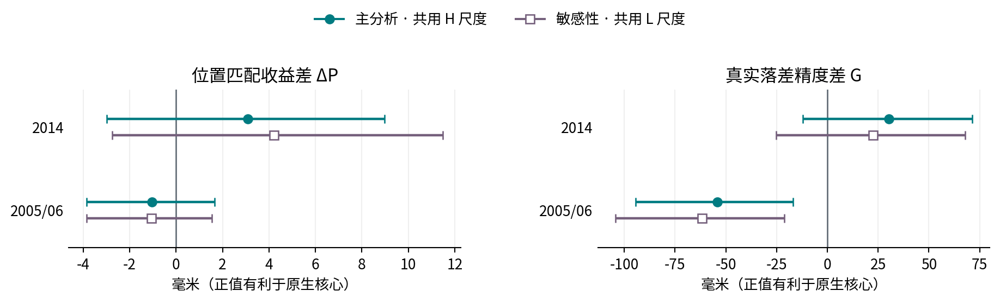

# 裁窗核心的原生细节是否帮助修正对准遮挡边界？

**两批布景都保留了位置匹配收益，但原生核心相对低通核心的额外贡献仍不确定。** 在 2014 年，保留原生细节使位置收益增加 3.10 mm，区间允许减少 2.99 mm 到增加 8.98 mm。在 2005/06 年，位置收益差为 −1.05 mm，而低通核心的**实际落差 MAE 比原生核心低 54.18 mm**（95% 区间 16.96 至 94.51 mm）。

固定全图预测 B、真实周边、裁窗视场、融合权重和四个尺度系数，只把窗内 RGB 换为按 B 实际输入栅格低通后还原的版本。H 表示原生核心，L 表示低通核心。对每条遮挡边取远侧三点中位深度减近侧三点中位深度，评价这个落差与真值相差多少。位置收益 P 衡量同场、同扫描方向、B 预测落差幅度同档时，修正用回原边界比随机分给另一条合格边平均少错多少，重配允许自配。下表两个配对差的正值都表示 H 占优。

| Middlebury 批次 | 场景／簇／边界 | H 位置收益 P（mm） | L 位置收益 P（mm） | 主指标 ΔP＝H−L（mm，95% 区间） | 实际精度差 G＝MAE(L)−MAE(H)（mm，95% 区间） |
|---|---:|---:|---:|---:|---:|
| 2014 | 23／23／188,235 | 13.61 | 10.51 | +3.10 [−2.99, +8.98] | +30.23 [−12.17, +71.25] |
| 2005/06 | 27／17／55,583 | 3.50 | 4.55 | −1.05 [−3.85, +1.65] | −54.18 [−94.51, −16.96] |

**一次全图与五次裁窗融合。** 2014 年 B、H、L 的实际落差 MAE 依次为 **344.24、337.77、368.00 mm**，H 相对 B 少错 6.47 mm [−24.69, +31.11]。2005/06 年依次为 **218.80、250.14、195.97 mm**，H 相对 B 多错 31.35 mm [6.22, 56.83]；L 相对 B 少错 22.83 mm [−13.71, +57.00]。这些布景尚未显示额外四窗带来稳定的落差精度收益。

**尺度与位置。** 改用从 L 估计的四个尺度、仍给 H/L 共用，2014 年 ΔP 为 +4.22 [−2.75, +11.49] mm，G 为 +22.51 [−25.27, +67.90] mm；2005/06 年分别为 −1.07 [−3.85, +1.54] 和 −61.61 [−104.18, −21.11] mm。主口径下，去细节后的 L 在两批仍有位置收益，区间分别为 [4.15, 20.13] 和 [1.93, 7.59] mm。较粗的轮廓、全图参照和模型先验均可能保留位置信息，本次干预无法区分其贡献。

**核验。** H 逐场复现历史 R，200 个窗的输入哈希均通过复算。两条件外圈 53,272,800 个像素位置逐元素相同；核心内至少一个通道改变的像素分别占 89.61% 和 88.05%。枚举档内重配平方误差后，两倍总体协方差及其 H−L 差分恒等式的最大残差为 1.12×10⁻¹⁵ m² 以内。以上为既有场景上预先冻结的新干预，区间按场景簇配对重采样 10,000 次，跨数据集泛化仍待确认。Asus 实际新增 200 个低通窗前向。

[逐场数据](results/per_scene.csv) · [汇总与区间](results/summary.csv) · [2014 原生／低通核心及 GT/B/H/L 剖面](figures/cases_2014.jpg) · [2005/06 核心及剖面](figures/cases_2005-2006.jpg) · [复现命令](README.md)
