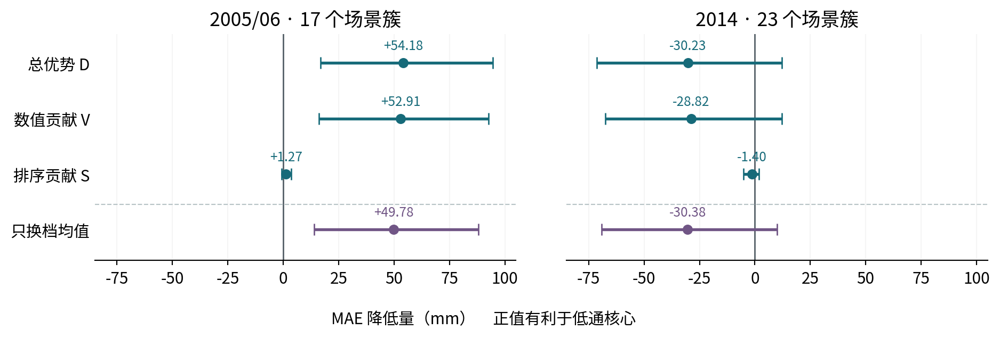

# 低通核心的 54.18 mm 优势从哪里来？

**在 2005/06 年，保留原生模型给边界排出的次序，只换成低通产生的整组有符号修正值，就能少错 51.96 mm [15.28, 91.55]。再简化一步，每档只换修正均值，仍能少错 49.78 mm [14.03, 88.15]。** 两者均以原生实测结果为参照。把低通修正从原生排序换回低通自己的排序，平均再少错 2.21 mm [−0.87, 5.99]。这批布景的主要收益来自各档的修正数值，尤其是均值的移动。

**四格绝对误差。** H 为原生核心，L 为低通核心。每个“场景 × 扫描方向 × B 预测落差幅度档”内，按指定顺序把修正从小到大分给各边。单位均为 mm，MAE 越小越好。

| 布景 | H 值、H 序（实测） | L 值、H 序 | H 值、L 序 | L 值、L 序（实测） | H 序、只换档均值 |
|---|---:|---:|---:|---:|---:|
| 2005/06 · 27 场／17 簇 | 250.14 | 198.18 | 249.82 | 195.97 | 200.36 |
| 2014 · 23 场／23 簇 | 337.77 | 368.69 | 341.27 | 368.00 | 368.15 |

**低通比原生少错多少。** V、S 是两种交换顺序下换数值、换排序的平均贡献，逐场满足 D＝V＋S。方括号为按场景簇配对重采样 10,000 次的 95% 区间。

| 布景 | 总优势 D（mm） | 数值贡献 V（mm） | 排序贡献 S（mm） | 只换档均值的收益（mm） |
|---|---:|---:|---:|---:|
| 2005/06 | +54.18 [16.96, 94.51] | +52.91 [16.20, 92.55] | +1.27 [−0.70, 3.68] | +49.78 [14.03, 88.15] |
| 2014 | −30.23 [−71.25, 12.17] | −28.82 [−67.36, 12.20] | −1.40 [−5.14, 1.80] | −30.38 [−69.06, 9.92] |

**交换顺序。** 2005/06 年先换值、后换序，两步收益依次为 **+51.96、+2.21 mm**；先换序、后换值则为 **+0.33、+53.85 mm**。低通排序使换值收益增加 1.89 mm [−1.46, 5.54]。保持原生排序时，从只换均值进一步换成完整低通分布，额外收益为 **2.18 mm [−1.72, 6.99]**，其大小和方向仍不确定。

2014 年先换值、后换序为 **−30.92、+0.69 mm**；先换序、后换值为 **−3.50、−26.73 mm**。换序对原生修正值增加误差 3.50 mm [0.12, 8.38]，对低通修正值则少错 0.69 mm [−2.78, 5.49]；两条路径的交互为 +4.19 mm [0.10, 9.84]。这一批的总收益点估计方向相反，区间跨零。

**尺度与范围。** 改为两条件共用低通尺度，2005/06 年 D、V、S、只换均值的收益依次为 +61.61、+60.47、+1.14、+56.18 mm；2014 年依次为 −22.51、−20.69、−1.82、−22.54 mm。两种尺度下的逐场实测误差均复现上轮。50 场共 243,818 条界面、495 个既有档，新增模型前向 0。本次是既有场景上的回顾性归因，交叉格只解释已产生的预测，本轮按冻结分档收束。[完整配对区间](results/summary.csv) · [逐场结果](results/per_scene.csv) · [复现命令](README.md)
