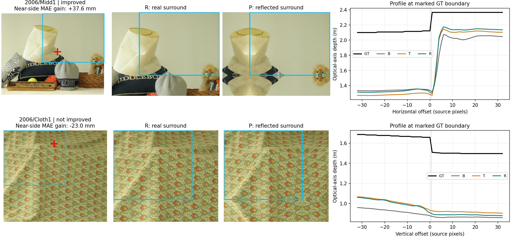

# 真实周边能否救回遮挡近侧的深度？
**在提出假设的 2014 年布景上能缓解；在独立的 27 个新布景上，效果尚未确认。** 以旧四窗 T 为参照，补真实周边 R 后，2014 的近侧 MAE 平均降低 **36.7 mm**［24.1, 50.4］，21/23 场改善。2005/06 合计只降低 **7.5 mm**［−4.3, 19.4］，15/27 场改善。新布景上，R 的近侧误差比等画布镜像对照 P 高 **6.7 mm**［−6.3, 20.8］，真实画面本身的独立收益仍不确定。

下表均为毫米。B 为默认全图；T 为全图与四个核心窗各半融合；25% 为统一降低局部拼图权重；P、R 保持核心的 RGB、大小与坐标相同，分别补镜像、真实周边。等权指同一跳变的近、远两侧各占一半。

**独立复验 · 2005/06，27 个布景、17 簇、55,583 条合格界面**

| MAE | B | T | 25% | P | R |
|---|---:|---:|---:|---:|---:|
| 近侧 | 557.5 | 573.6 | 564.8 | 559.5 | 566.2 |
| 远侧 | 501.8 | 466.2 | 479.6 | 489.3 | 468.2 |
| 两侧等权 | 529.6 | 519.9 | 522.2 | 524.4 | 517.2 |

旧权衡在两年合计重现：T 相对 B 近侧恶化 16.1［2.1, 34.0］，远侧改善 35.6［4.7, 67.7］。R 保留了相对 B 的远侧改善 **33.6**［10.8, 57.7］，但相对 T 的远侧收益为 −2.0［−22.5, 15.0］。R 相对 B 的近侧收益为 **−8.7**［−20.8, 2.9］，等权收益为 **+12.4**［−1.5, 26.8］；相对 25% 融合的等权收益为 +5.0［−4.7, 15.1］。真实跳变幅度的绝对误差反而较 B **增加 31.3**［6.2, 56.8］，全图 MAE 的收益为 −0.4［−10.1, 7.9］。目前没有足够依据用 R 替换默认全图。

**发现样本复查 · 2014，23 个布景、23 簇、188,235 条合格界面**

| MAE | B | T | 25% | P | R |
|---|---:|---:|---:|---:|---:|
| 近侧 | 1,030.1 | 1,091.6 | 1,060.1 | 1,071.8 | 1,054.9 |
| 远侧 | 1,258.4 | 1,204.2 | 1,229.1 | 1,230.1 | 1,220.5 |
| 两侧等权 | 1,144.2 | 1,147.9 | 1,144.6 | 1,150.9 | 1,137.7 |

复现了 T 在 22/23 场近侧恶化、20/23 场远侧改善。近侧有符号残差（预测减真值）从 B 的 −966.6 变为 T 的 −1,038.7，R 回到 −1,000.0。R 的近侧仍比 B 差 24.8［6.7, 46.5］。R 相对 P 的近侧收益为 +16.8［−3.1, 41.0］；共同固定 T 的四个尺度系数后变为 +50.8［21.8, 81.1］。在新布景上，相应比较从 −6.7［−20.8, 6.3］变为 +3.0［−31.5, 36.5］。外圈内容的判断随尺度处理和样本而变。

**年份与成本。** 分年看，主比较 T−R 的近侧收益在 2005 为 +12.7［−6.9, 32.5］，2006 为 +4.6［−9.3, 20.1］。2005 单年旧 T 的远侧优势也未重现。新样本上 B、T、R 的单图实测中位分别为 42、148、257 ms。T 与 R 都评五个视图，R 用更大的编码器画布。Asus 两张 RTX 4090 共新增 535 次正式图像前向，复用 115 个旧预测，合成检查与计时另计 260 次。区间按场景簇配对重采样 10,000 次。iBims-1 同坐标高清真值仍缺，本次未纳入。

固定案例中，Midd1 的全场近侧 MAE 降低 37.6 mm，Cloth1 增加 23.0 mm。图中红十字取距中心最近的合格界面，蓝框表示三个条件共有的核心。右图是该界面的轴向剖面，标题中的收益是整场近侧汇总。[移动方向、逐年几何与成本](diagnostics.md) · [完整配对结果](summary.csv) · [复现命令](README.md)

