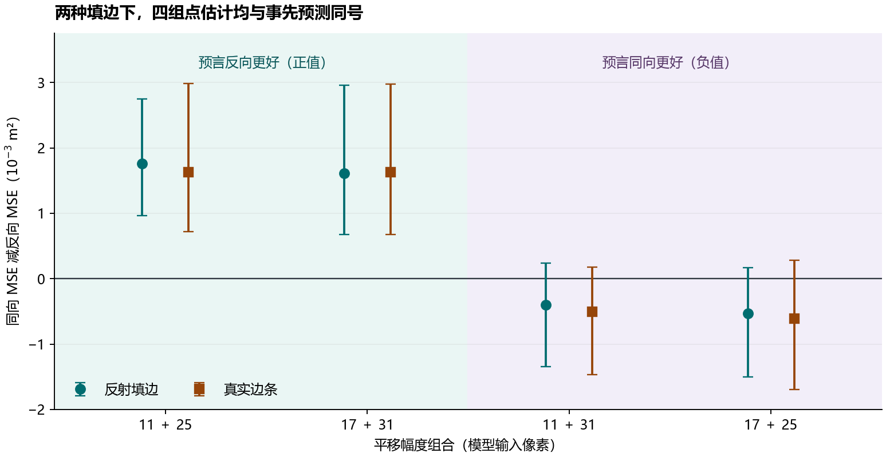

# 能在推理前预言哪次平移该同向吗？

**在这 32 个既有 NYU 场景中，14 像素网格预言了四组平均结果的符号，但“何时同向更好”还没通过冻结的检验。** 在两种填边下，同余数组都是反向更好；异余数组都是同向的点估计更好，但场景配对区间均跨零。最稳定的发现是，从同余数组换到异余数组，**32/32 个场景的反向优势都下降**，换成真实边条仍为 32/32。

### 两种解释在哪些组合上分出高下？

把两个位移都写成向右的正数，再看各自除以 14 后最靠近零的余数。11＋31 对应 −3、＋3。如果两次向右，两个非原图视图的相位分别落在原点两侧。位置平滑假说预言反向更好，网格假说在这组预言同向更好。下表给出 **G＝同向区域深度差 MSE 减反向 MSE**，单位均为 **10⁻³ m²**；正值偏向反向。区间由 32 个完整场景配对重采样得到。

| 预先指定的比较 | 反射填边 G［95% 区间］ | 真实边条 G［95% 区间］ |
|---|---:|---:|
| 同余数，11＋25、17＋31；预言反向更好 | **+1.688**［+0.912, +2.732］ | **+1.629**［+0.787, +2.761］ |
| 异余数，11＋31、17＋25；预言同向更好 | **−0.467**［−1.415, +0.181］ | **−0.556**［−1.567, +0.189］ |
| 同余数组减异余数组的配对差 | **+2.155**［+0.998, +4.017］ | **+2.184**［+0.988, +4.111］ |

同余数组的场景平均在两种填边下各有 32/32 个场景偏向反向；异余数组分别有 20/32、19/32 个场景偏向同向。边条替换后，表中第三行的变化为 +0.029［−0.183, +0.236］×10⁻³ m²。相位组间差异在真实上下文下仍可观察到。分块、位置编码和深度解码器各自贡献多少，仍需单独的干预。

### 给定三次预算怎样选？比只看一次原图好多少？

固定规则在同余数组选反向，异余数组选同向，四个幅度组合等概率。反射填边下，规则相对**全选反向**仅少 0.000234 m²，95% 区间［−0.000091, +0.000708］；相对**一次原图**少 0.030672 m²［+0.000373, +0.080003］。固定反向本身相对一次原图也少 0.030439 m²。多算两次在这批场景的均值上有收益，其中有多少能归功于提前选方向，仍不确定。真实边条下，规则相对固定反向、原图分别少 0.000278 m²［−0.000095, +0.000784］和 0.023589 m²［+0.001461, +0.060172］。[全部绝对误差与配对差](summary.csv)

### 实验范围

每个场景预先抽一帧。模型实际分块卷积核和步长均为 14。为单独比较边条，所有配方均使用同一中央 518×602 输入画布，一次原图基线也使用这块画布。每帧的 9 个反射臂视图产生 **288 次主实验前向**；共享原图，再加 256 次真实边条前向，总计 **544 次**。两阶段评分共 18.67 秒，其中同步模型前向 7.96 秒。全部 3,486 个主分析区域对使用同一有效区，27,888 项方向乘积核验的最大残差为 2.14×10⁻¹⁴ m²。四个位移都未按结果调整。两臂均未满足严格翻转门槛，未启用新的 RGB-D 确认集。[冻结方案](protocol.md) · [逐场景结果](frame_results.csv) · [复现命令](README.md)
