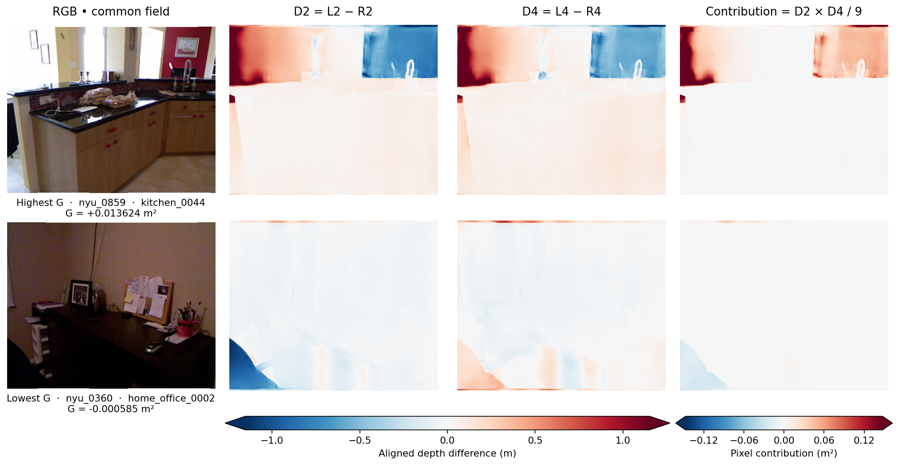

# 三次深度推理，平移该往同一侧还是两侧？

**同样每帧算三次，反向搭配比同向搭配平均少 0.001000 m² 的 MSE**（95% 区间 **0.000703 至 0.001363**）。128 帧中，反向在 **127 帧更好、1 帧更差、0 帧持平**。方向一致，但量级约为同向策略帧均 MSE 的 0.16%。

**相比只看原图，反向搭配平均少 0.001942 m² 的 MSE**（95% 区间 **−0.003775 至 +0.008776**）。它在 58 帧上降低误差、70 帧上增加误差。就这批开发帧，已有三次预算时更宜反向搭配；为此多做两次推理能否稳定胜过原图，仍有不确定性。

| 每帧策略 | 部署前向数 | 帧均 MSE（m²，越低越好） | 相对原图节省的 MSE（95% 区间，m²） | 比原图好 / 差 / 平（帧） |
|---|---:|---:|---:|---:|
| 原图 | 1 | 0.629714 | 基准 | — |
| 同向平移 | 3 | 0.628772 | +0.000942［−0.004630，+0.007654］ | 56 / 72 / 0 |
| 反向平移 | 3 | 0.627772 | +0.001942［−0.003775，+0.008776］ | 58 / 70 / 0 |

**为什么反向占优？** 把左移预测深度减去右移预测深度，在 2% 与 4% 下分别得到 D2 和 D4。两者同号时，反向搭配会抵消一部分随方向产生的预测偏移。以每帧全部有效像素为分母，同号像素对平均收益贡献 **+0.00103646 m²**，异号像素贡献 **−0.00003607 m²**，合计 **+0.00100039 m²**。两类策略对各自两套配方取平均时，得到的平均预测相同；差别来自实际部署时每帧只选一套，配方间的预测波动不同。逐帧从四套配方 MSE 算出的收益，与独立计算的 D2×D4/9 像素均值最多相差 1.38×10⁻¹⁵ m²。

厨房帧 nyu_0859 的收益最大（**+0.013624 m²**），图上方两种幅度的深度差大面积同号。家庭办公室帧 nyu_0360 是唯一负例（**−0.000585 m²**），左下区域两种幅度的深度差异号。红色贡献表示当地像素有利于反向，蓝色有利于同向。两帧使用相同色标，显示截幅不影响数值计算。

**口径与成本。** 复用 NYU 的 128 个已有开发帧、95 个场景与固定的 Depth Anything V2 Metric Indoor Small。每套配方含原图和 2%、4% 两个平移视图；先平均三张逆对齐预测再求 MSE，最后等权平均该策略的两套配方误差。各帧等权，所有比较共用同一有效区；区间按场景整簇配对重采样 10,000 次。Asus 物理 3 号 RTX 4090 复用 128 个原图预测，新算 512 个平移预测，另作 2 次原图复验；实际前向 514 次，两阶段墙钟共 27.87 秒。[逐帧结果](frame_results.csv) · [汇总表](summary.csv) · [协议与复现命令](README.md)
